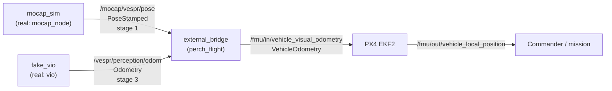
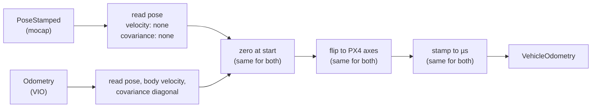

# Design: external_bridge

Status: implemented and flown in the sim (2026-11-15) on mocap, VIO and the real drone's clock path: [results](../../src/perch_eval/results/external_bridge_2026-11-15.md). Not yet tested: a start heading other than 0°, noisy input, a reset mid-flight.

The bridge must work on the real drone as well as in the sim. The PX4 parameter file here is the sim's; the real drone's PX4 parameters are tracked separately.

## Goal

Give PX4 an outside position and heading so its estimator (EKF2) flies on it. In stage 1 that is mocap; in stage 3 it is VIO. One node takes either one, converts it to what PX4 expects, and publishes it. Switching the source is one launch argument, and nothing in the mission changes.

PX4 calls an outside position source **external vision (EV)**, whatever it really is, so its settings for it are all named `EKF2_EV_*`.

## What it does



| | |
|---|---|
| Node | `external_bridge`, package `perch_flight` |
| Input | `input`, remapped by the launch file. Type set by the `input_type` parameter: `pose` (`geometry_msgs/msg/PoseStamped`) or `odom` (`nav_msgs/msg/Odometry`) |
| Output | `/fmu/in/vehicle_visual_odometry`, `px4_msgs/msg/VehicleOdometry`, same QoS as `Commander` (`PX4_QOS`) |

Mocap stays `PoseStamped`; the mocap repo doesn't change. This is the "convert in one node only" rule from [NAMING.md](../NAMING.md) section 8.

Why `/fmu/in/vehicle_visual_odometry` for mocap too: PX4 also has `vehicle_mocap_odometry`, but EKF2 never reads it. Only PX4's older estimators (LPE, Q attitude estimator, both unused) read it; otherwise PX4 just records it in its flight log.

## How each input becomes `VehicleOdometry`

Mocap and VIO differ only in what they carry, so each gets a small reader, and everything after that is shared:



| Step | Mocap | VIO |
|---|---|---|
| Read | position, orientation. Velocity and variances NaN | position, orientation, body velocity, turn rates, covariance diagonals |
| Zero at start | average the first second of samples (the start); subtract its room position, turn by its heading | the same. VIO is already near zero at its own start, but may have started long before the bridge (on the Jetson's boot, then carried or left to drift): zeroing again lines it up with when the bridge started |
| Flip | the same | the same; velocity and turn rates flip too |
| Stamp | the same | the same |

## Origin: zero at start (decided)

PX4's local frame (`/fmu/out/vehicle_local_position`) is a **fixed** frame, not one that moves with the drone. Today, flying on flow, its origin is where PX4's estimate started (the takeoff spot) and its x points north, from the compass. `Commander`'s positions (`goto(north, east, altitude)`) and the planner's phase 1 targets are in it.

With EV heading fused, PX4 takes the EV frame as its own (checked in PX4 v1.16, `ev_pos_control.cpp`). So the bridge sends positions **from where the drone was at the start**, with x along the way the drone faced then, kept level. That is exactly how `fake_vio` defines its frame, so:

- PX4's origin stays the takeoff spot, as today. `Commander` and phase 1 targets keep their meaning.
- Stage 1 (mocap) and stage 3 (VIO) give PX4 the same frame. The swap changes nothing in the mission.
- What changes: x is the drone's starting heading, not north, because the compass is off. Everything that says "north" now means "the way the drone faced at the start" (below).

### What changes for `Commander`, the CLI and the mission

Moves relative to the nose don't change. Positions and headings given in the fixed frame turn with the drone's starting heading. Example: the drone starts facing 45° (north-east).

| Command | Today (compass, x = north) | With `EV` (x = starting heading) |
|---|---|---|
| CLI `forward 0.5` (`move_body`) | 0.5 m along the nose (north-east): PX4 says yaw 45°, `move_body` turns the move by it | 0.5 m along the nose (north-east): PX4 says yaw 0°, the move isn't turned. **Same flight** |
| CLI `yaw 30` (`yaw_by`) | turns 30° clockwise | same |
| CLI `goto 1 0 1.5` | 1 m north | 1 m along the starting heading: north-east |
| CLI `status` heading | 45 | 0 |
| `fly_square` waypoints | a square lined up with north | the same square, lined up with the starting heading |
| Mission goal `{north, east, heading}` | compass directions | measured from the starting heading |
| Planner phases 2 and 3 | relative to the drone and branch | same |

**Decided (indoor first):** with `EV` on, `goto <north> <east> <alt>` already means `goto <forward> <right> <alt>` from where the drone started, because the bridge makes PX4's x the starting heading. `Commander`'s logic doesn't change. Only the words `north`, `east` and "0 = facing north" in `Commander`, `flight_cli`, `fly_square` and the mission goal are wrong while `EV` is on; renaming them is optional and separate. Outdoor flights (GPS, true north) are decided later.

The start is the average of the bridge's first second of input (parameter `zero_window`, 1 s by default), taken while the drone sits on the ground. Nothing goes to PX4 during that second. A re-launch from the branch doesn't move it, since the bridge keeps running.

**Why an average, not the first sample.** The start is subtracted from every later sample, so its error doesn't average out like the rest of the noise: it stays in PX4's frame for the whole flight, as a fixed shift and turn. The noise sweep ([noise_sweep_2026-11-21.md](../../src/perch_eval/results/noise_sweep_2026-11-21.md), on the eval branch) zeroed on one sample and got up to 7 cm off with 2 cm of mocap noise, and 14 cm and 5° with 5 cm and 0.05 rad of VIO noise. Averaging n samples cuts that by √n. The window is set in time, not samples, so n is whatever arrives in that second; the log gives it. In the sim, a 1 s window gave 2–3 cm of zero error for VIO and under 1 cm for mocap at the sweep's high noise. Headings are averaged as directions, so 179° and −179° give 180°. The bridge logs the spread of the samples it averaged: if the drone moved during the second, the start is where it was on average.

Phases 2 and 3 use only the branch relative to the drone (from the detector), so the origin doesn't affect them. The evaluator reads mocap directly, in the room frame, so it isn't affected either.

**Zeroing again.** If the input's stamps jump back more than 1 s (a sim reset, as in `fake_vio`), the bridge averages a new start (another second without sending) and raises `reset_counter`, so PX4 knows the jump is deliberate. A sample only slightly older than the last one arrived out of order (Wi-Fi) and is dropped, never zeroed on: PX4 already has a newer one.

**If the bridge restarts mid-flight**, it zeroes again where the drone is then (on average over that second, so off by up to about half a second of flight). Its `reset_counter` starts from a random value, so it most likely differs from the last one PX4 saw (1 in 256 that it doesn't). PX4's frame still moves under `Commander`'s target. A real VIO restart does the same, so stage 3 will need a way to handle it anyway. Not handled now.

`fake_vio`'s helpers in `perch_sim/poses.py` are the reference for zeroing. The bridge needs its own copy, since `perch_flight` must not depend on `perch_sim`.

## Flip to PX4's axes

ROS is x forward, y left, z up. PX4 is x forward, y right, z down. After zeroing, x is the starting heading, not north, so the bridge says the frame is **FRD** ("fixed, any heading") rather than NED ("x is true north"). The flip is a 180° turn about x:

| Field | ROS value | `VehicleOdometry` |
|---|---|---|
| Position | `(x, y, z)` | `(x, -y, -z)`, `pose_frame = POSE_FRAME_FRD` |
| Orientation | `(w, x, y, z)` | `q = [w, x, -y, -z]`, normalised |
| Velocity (VIO only) | body twist `(vx, vy, vz)` | `(vx, -vy, -vz)`, `velocity_frame = VELOCITY_FRAME_BODY_FRD` |
| Angular velocity (VIO only) | `(wx, wy, wz)` | `(wx, -wy, -wz)` |

**Normalise the quaternion.** EKF2 rejects one whose length is off from 1 by more than 0.00001, which a noisy sample can be.

## Timestamps

Every sample says when it was measured. EKF2 needs that time on **PX4's clock**, to line the sample up with the IMU readings from the same moment. PX4 uses the stamp exactly as it arrives; it doesn't convert it.

There are three clocks, and the input's stamps can be on either of two:

| Where | Input stamps | PX4's clock | What the bridge does |
|---|---|---|---|
| Sim | Gazebo's clock: seconds since the sim started (`mocap_sim`, `fake_vio`) | also Gazebo's: SITL sets its clock from it (`GZBridge::clockCallback`) | converts to µs, nothing else |
| Real drone | the system clock: time of day, seconds since 1970 (mocap PC, Jetson) | a stopwatch, seconds since the Pixhawk powered on | adds PX4's measured gap |

The sim isn't stamping wrong: Gazebo time is how ROS stamps in a simulator, and it stays right when Gazebo runs slower than real time. The sim keeps its stamps; the bridge adapts.

**Auto-detected, no setting.** The bridge tells the two apart by size. A system-clock stamp is over 10⁹ s (about 1.76 × 10⁹ s in 2026); Gazebo and PX4 times are seconds to hours, nowhere near 10⁹ s (32 years). Rule: **stamp ≥ 10⁹ s means system clock, so add the gap; otherwise it is already on PX4's clock.** The bridge logs which it detected on the first sample, and warns if a later sample switches.

This rule must be explained where it is coded. The constant in `external_convert.py` gets a comment block saying: the three clocks, why sim stamps are already PX4's clock, why 10⁹ s separates them, and a pointer to this section. The node's docstring and the `perch_flight` README say the same in one line.

**The gap.** About once a second PX4 and the Jetson's DDS agent compare clocks. PX4 publishes the result on `/fmu/out/timesync_status`; `estimated_offset` is the smoothed gap in µs. The bridge adds it to each system-clock stamp. Until the first `timesync_status` arrives, the bridge publishes no system-clock samples (and logs why), since a guessed time is worse than no sample. In the sim it never needs `timesync_status`.

**Where the stamps come from on the real drone.**

- **VIO** runs on the Jetson, so its stamps are already on the Jetson's clock.
- **Mocap** stamps on the mocap PC. Its clock has to agree with the Jetson's. The plan already requires this: the evaluator compares mocap and vision on "1 shared clock" ([mocap.md](../system-map/mocap.md#the-two-repo-boundary)). It is an operating-system setting (chrony, the standard Linux clock-sync service), not code in the mocap repo. Make the **mocap PC the time server** and the Jetson follow it: then the mocap PC still knows nothing about the drone, and the one rule is untouched.
- If the two clocks disagree by 10 ms, every mocap sample is fused 10 ms early or late: about 5 mm of error at 0.5 m/s. Check the agreement with `chronyc tracking` on the Jetson before a flight.

`timestamp` (when it was sent) is only logged by PX4. The bridge sets it equal to `timestamp_sample`: in the sim it has no Gazebo clock to tell when the sample arrived.

## The other fields

| Field | Mocap | VIO |
|---|---|---|
| `position_variance`, `orientation_variance` | NaN: PX4 uses its own settings (`EKF2_EVP_NOISE`, `EKF2_EVA_NOISE`) | The diagonal of the `Odometry` pose covariance |
| `velocity_variance` | NaN | The diagonal of the twist covariance |
| `reset_counter` | starts at a random value, plus one each time the bridge zeroes again | same |
| `quality` | 100 | 100 for now |

**PX4 never trusts a sample more than its own setting.** EKF2 uses the larger of the message's variance and `EKF2_EVP_NOISE²` (default 0.1 m) or `EKF2_EVA_NOISE²` (default 0.1 rad). With the defaults, mocap would be treated as 10 cm accurate whatever it says. So for mocap the parameter file sets these, and the message leaves them NaN: one place to tune.

## The sim's PX4 parameter file

Every PX4 setting the sim changes lives in one file: `perch_sim/config/x500_hook.params`, next to `x500_hook.yaml`.

- **Format:** PX4 shell commands, the same as an airframe file: `param set-default NAME VALUE`, each with a comment saying why.
- **Read by:** `4920_gz_x500_hook`, which sources it after PX4's X500 airframe. `run_sim.sh` passes its path in `PERCH_PX4_PARAMS`.
- **Moves out of the airframe:** everything it sets today (GPS off, flow and rangefinder positions, `EKF2_MIN_RNG`, `EKF2_OF_DELAY`, `EKF2_MAG_DECL`, hover thrust, `NAV_DLL_ACT`). The airframe keeps only the model name, PX4's X500 and the line that sources the file. The `GPS` and `EV` options become `if` blocks in the file.

**New: the `EV` option**, like `GPS=1`. One value per source, because flow is off in stage 1 and on after it:

```
run_sim.sh perch_rod gz_x500_hook            # today: flow + rangefinder + compass
EV=mocap run_sim.sh perch_rod gz_x500_hook   # stage 1: flies on mocap, flow off
EV=vio run_sim.sh perch_rod gz_x500_hook     # stage 3: flies on VIO, flow on as a helper
```

| Parameter | `EV=mocap` | `EV=vio` | Off (today) | Why |
|---|---|---|---|---|
| `EKF2_EV_CTRL` | 15 | 15 | 0 | Fuse horizontal and vertical position, velocity and heading. Mocap sends no velocity, so that part does nothing for it |
| `EKF2_HGT_REF` | 3 (vision) | 3 (vision) | 1 (GPS; the barometer without GPS) | Height from the bridge |
| `EKF2_MAG_TYPE` | 5 (none) | 5 (none) | 0 | Heading comes from the bridge. The compass points north, not along the starting heading, and would fight it |
| `EKF2_OF_CTRL` | 0 | 1 | 1 | Stage 1: flow off, so a steady hover proves the bridge is doing the work. Stage 3: flow helps when VIO is weak |
| `EKF2_EVP_NOISE` | 0.01 m | 0.1 m (PX4 default) | 0.1 | Mocap's accuracy; VIO sends its own covariance. Starting values: tune in the hover test |
| `EKF2_EVA_NOISE` | 0.02 rad | 0.1 rad (PX4 default) | 0.1 | Same |
| `EKF2_EV_DELAY` | 0 ms | 0 ms | 0 | Stamps are the true sample time |
| `EKF2_EV_POS_X/Y/Z` | 0 | 0 | 0 | Both sources report `base_link`, the body centre |

`EV` must match the bridge's `source`. Stage 2 (mocap flies, vision logged) uses `EV=mocap`.

The rangefinder stays on: `Commander` reads `dist_bottom` from it.

## Parameters

| Name | Default | Meaning |
|---|---|---|
| `input_type` | `pose` | `pose` (PoseStamped) or `odom` (Odometry) |

The input's clock is detected, not set (see Timestamps).

## On the real drone

The same node, with the same launch, runs on the Jetson. What differs from the sim, and what the bridge does about it:

| Real-drone difference | The bridge |
|---|---|
| Stamps on the system clock, not PX4's | detects it, adds the gap from `/fmu/out/timesync_status`; publishes nothing until it has one |
| Mocap stamps come from the mocap PC | relies on chrony (mocap PC as time server). Not the bridge's job, but listed in its README as a pre-flight check |
| Mocap arrives over Wi-Fi: late or missing samples | passes stamps through unchanged, so a late sample is fused at the right moment. Logs a warning if no input for 0.2 s. PX4 decides what to do without it (with flow off in stage 1, it loses its position estimate and fails safe) |
| Mocap at 120 Hz | passes all of them. PX4 takes at most one per estimator step (about 100 Hz) and drops the rest |
| The mocap rigid body must be defined at `base_link` | assumes it is, as [mocap_sim.md](mocap_sim.md) already requires |
| The room's "up" comes from the L-frame calibration | assumes z is truly up when zeroing level. A tilted ground plane tilts PX4's frame |

Also needed on the real drone, outside the bridge: the `EKF2_EV_*`, `EKF2_HGT_REF`, `EKF2_MAG_TYPE` and `EKF2_OF_CTRL` settings above, and `UXRCE_DDS_SYNCT` 1 (time sync on). Tracked by whoever owns the real drone's PX4 parameters.

## Launch

`perch_flight/launch/external_bridge.launch.py`, with a `source` argument:

| `source` | Remaps `input` to | `input_type` |
|---|---|---|
| `mocap` (default, stage 1) | `/mocap/vespr/pose` | `pose` |
| `vio` (stage 3) | `/vespr/perception/odom` | `odom` |
## Files

| File | Contents |
|---|---|
| `perch_flight/perch_flight/external_bridge.py` | The node: the two readers, publishing |
| `perch_flight/perch_flight/external_convert.py` | Pure functions: zeroing, the flip, stamp conversion |
| `perch_flight/launch/external_bridge.launch.py` | As above. `setup.py` gains the launch file and the entry point |
| `perch_flight/test/` | Unit tests for `external_convert.py`, node test with fake input |
| `perch_sim/config/x500_hook.params` | The sim's PX4 settings, above |
| `perch_sim/airframes/4920_gz_x500_hook` | Settings move out; sources the file |
| `perch_sim/scripts/run_sim.sh` | `EV` option; exports `PERCH_PX4_PARAMS` |
| READMEs of both packages | the bridge, the `EV` option, the parameter file |

## Testing

- **Unit:** the flip on known poses (facing +y in ROS is facing −y in FRD); zeroing at the start position and heading; the start averaged over the window, headings across ±180°; nothing sent before the window ends; NaN velocity and variances for mocap; covariance diagonal for VIO; quaternion normalised; stamp in µs; clock detection on both sides of 10⁹ s (a Gazebo stamp of a few minutes passes through unchanged, a 2026 time-of-day stamp gets the gap added); `reset_counter` rises on a re-zero.
- **Node:** fake `PoseStamped` and `Odometry` in, check the published `VehicleOdometry`. With system-clock stamps: nothing published before a fake `timesync_status`, then stamps shifted by its offset.
- **The real-drone clock path, in SITL.** SITL runs the same time sync against the computer's clock as the Pixhawk does against the Jetson. A small test-only node re-stamps `mocap_sim`'s output with the system clock (as the real mocap PC does); the bridge detects it and converts. Pass: same hover and same `estimator_status_flags` as with Gazebo stamps. This tests the real drone's clock handling without the drone.
- **Parameter file:** with `EV` off, the sim flies exactly as before the move (same `param show` output from PX4, same hover).
- **Sim, mocap source, noise off:**
  1. `EV=mocap run_sim.sh perch_rod gz_x500_hook`, `mocap_sim`, `external_bridge`. Spawn the drone facing 45° to check the heading table above: `forward 0.5` goes along the nose.
  2. In the PX4 shell, `listener estimator_status_flags`: `cs_ev_pos`, `cs_ev_hgt`, `cs_ev_yaw` true; `cs_opt_flow` and `cs_mag_hdg` false.
  3. Before takeoff: `/fmu/out/vehicle_local_position` is about 0.
  4. Take off, hover 30 s, fly the square (`fly_square`). Compare PX4's position with mocap (start pose subtracted) over the flight, and plot the flight path against the same flight on flow.
- **Sim, mocap noise on** (`position_noise` 2 mm): still holds position; tune `EKF2_EVP_NOISE` if it twitches or drifts.
- **Sim, VIO source:** same flight with `EV=vio`, `source:=vio` and `fake_vio`; `cs_opt_flow` now true as well. With noise off, PX4's position matches the mocap run.

## For the team

- **Stage 1 now means mocap goes into PX4's estimator**, not just a remap of the mission's pose input. The system map's [mocap.md](../system-map/mocap.md#phasing-out-mocap) and [topics-and-interfaces.md](../system-map/topics-and-interfaces.md) ("vision (stage 3)") should say so; update the FigJam board, then re-sync.
- **The stage switch moves** to this node: `source:=mocap` → `source:=vio`. The mission doesn't change. The stage 3 proof (`ros2 topic info /mocap/vespr/pose` lists only the evaluator and the bag recorder) still works: in stage 3 the bridge no longer subscribes to it.
- **The real drone** needs the PX4 settings and chrony listed under "On the real drone". Tracked by whoever owns the real drone's PX4 setup.
- **"North" means the starting heading** while `EV` is on: indoors, `goto` targets and mission goals are forward/right of where the drone started. Set up a flight by placing the drone facing the branch.

## Out of scope

- The real drone's PX4 parameters and chrony setup (the bridge's side of the real drone is in scope).
- Renaming `north`/`east`.
- Handling a bridge or VIO restart mid-flight.
- VIO quality, mocap velocity.
- Mocap into PX4's log (`/fmu/in/vehicle_mocap_odometry`) in stage 3, so the `.ulg` holds the truth next to PX4's estimate. PX4 doesn't fly on it, so the one rule holds. A later idea.

## Open questions

None.
