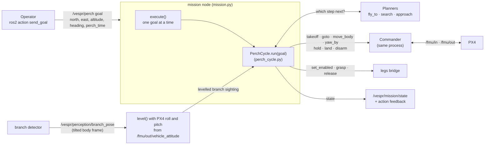
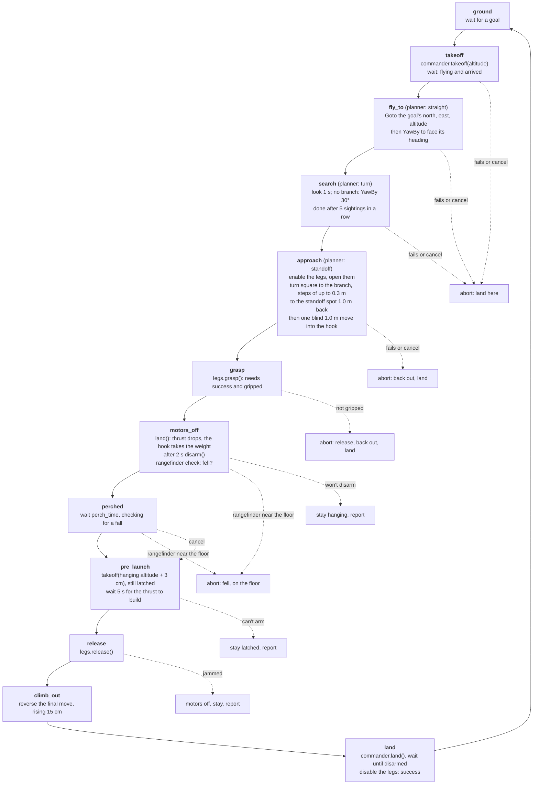
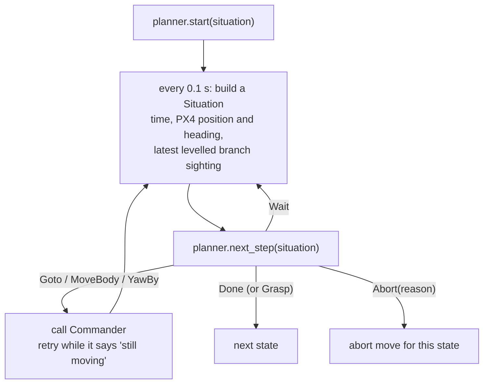

# Mission flow: how mission.py works

A walk-through of the mission node with diagrams. The design and its open issues: [mission.md](mission.md). The planners: [planning.md](planning.md).

## Run it in the sim

Build once after changes:

```bash
cd ~/vespr && colcon build --packages-select vespr_interfaces perch_flight vespr_flight && source install/setup.bash
```

One command starts everything (DDS agent, PX4 and Gazebo with its window, fake branch detector, sim legs, mission node) and sends a perch goal:

```bash
~/vespr/src/vespr_flight/scripts/sim_mission.sh
```

- It prints each state and each move as the mission makes it, then the result.
- After the goal, everything keeps running so you can look around. **Ctrl+C stops everything**, landing the drone first if it is flying.
- Full logs of each part: `/tmp/vespr_sim_mission/`.
- In Gazebo, right-click `x500_hook_0` → **Follow** to keep the camera on the drone.

| Option | Effect |
|---|---|
| `NO_GOAL=1` | Start everything without sending a goal; it prints the command to send one |
| `GOAL='{north: 0.3, east: 0.8, altitude: 1.3, heading: 60.0, perch_time: 30.0}'` | A different goal |
| `PARAMS=~/my_settings.yaml` | Your copy of [config/mission.yaml](../../src/vespr_flight/config/mission.yaml) |
| `HEADLESS=1` | No Gazebo window |
| `WORLD=perch_branch` | Another world |

## How the pieces fit together



- **mission.py** is the ROS side: the `/vespr/perch` action, the subscriptions (branch sightings, PX4 attitude), the legs clients, the state topic.
- **perch_cycle.py** is the logic: the states in order and the abort for each. It has no ROS in it, so it is unit tested with fakes.
- **Commander** flies PX4. It runs in the same process, and the mission calls its methods directly.

## The perch cycle: what happens in each state



In every state:
- **Pilot takeover:** the mission stops commanding at once. No abort move.
- **Cancel or Ctrl+C:** the abort move for the current state. Cancelled while perched, it leaves the branch normally.

| State | Board state | Who does the work |
|---|---|---|
| takeoff | 2 | Commander |
| fly_to | (new) | fly_to planner + Commander |
| search | 3 | search planner + Commander |
| approach | 4 to 6 | approach planner + Commander; legs enabled and opened |
| grasp | 7 | legs |
| motors_off | 8 | Commander (land, then disarm) |
| perched | 9 | nothing: waiting |
| pre_launch | 10 | Commander (takeoff while latched) |
| release | 11 | legs |
| climb_out | 12 | Commander |
| land | 13 | Commander, then legs disabled |

## How a planner phase runs

fly_to, search and approach all run the same loop, `fly()` in perch_cycle.py:



**Why planners return Wait so often:** Commander can't say when a move has finished. So each planner works out how long its own move takes (length ÷ speed, or angle ÷ 30°/s), waits that long plus `settle_time` (0.5 s), and only trusts branch sightings taken after that. A sighting taken mid-move would aim the next step from the wrong place.

## Where the numbers come from

Every number above is a setting in [config/mission.yaml](../../src/vespr_flight/config/mission.yaml): the planners, their speeds and distances, the timeouts, the fall height, the lifts. Copy the file to experiment and pass it with `PARAMS=`.
