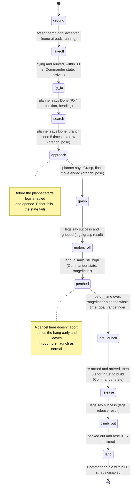
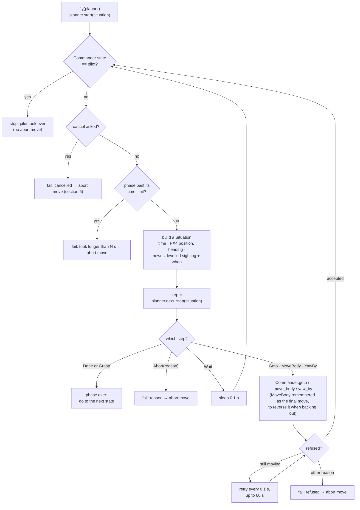
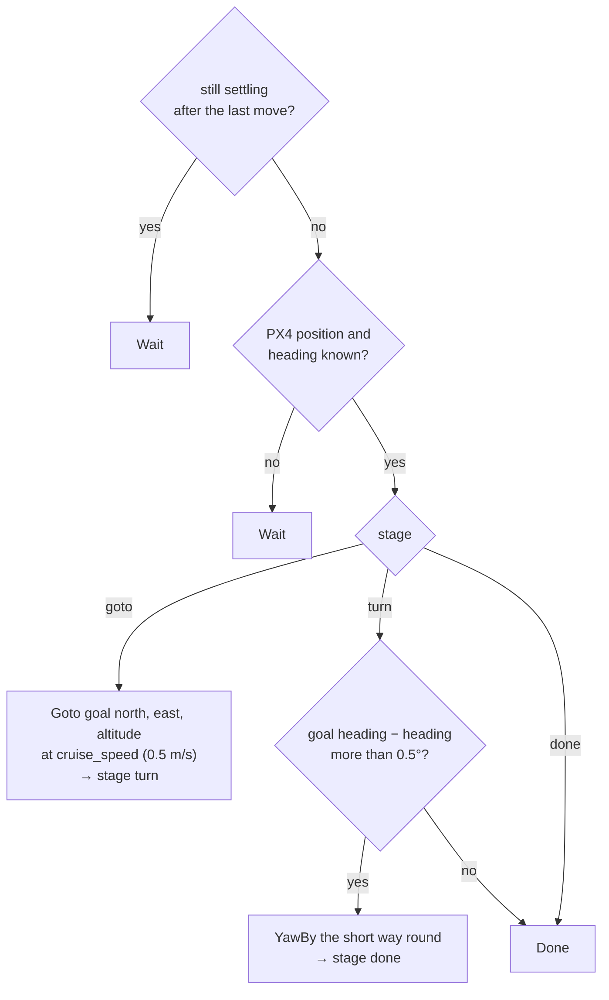
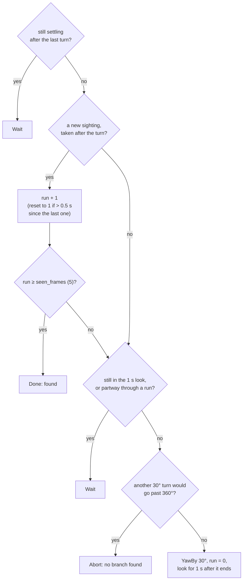
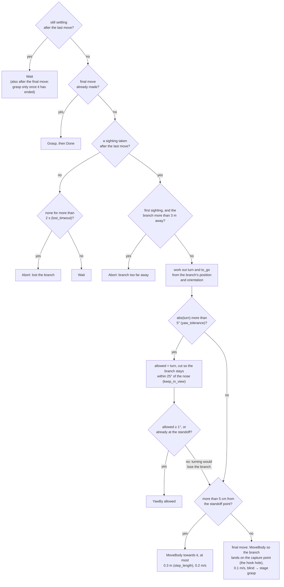
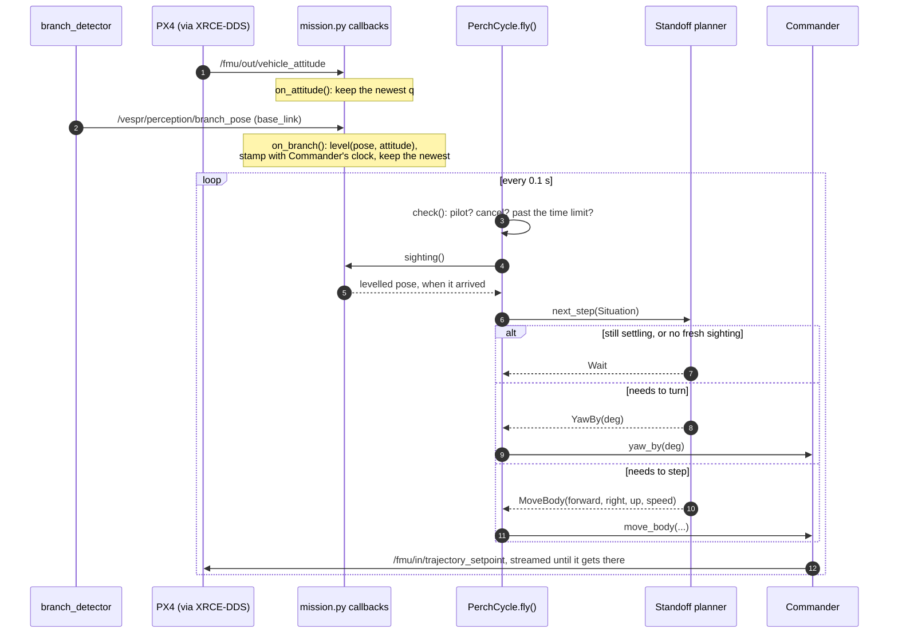
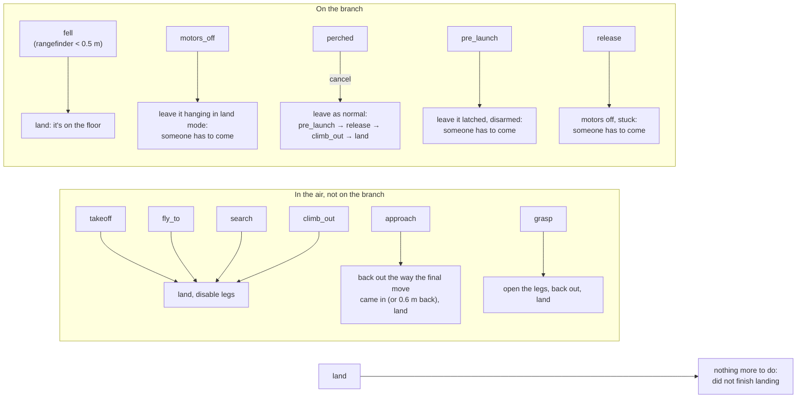

# Mission logic: what the mission decides, and from what data

The [system diagram](system_diagram.md) shows where the mission's data comes from. This page shows what the mission *does* with it: every decision, the test behind it, and the data the test reads. It is drawn from the code in `perch_mission`: [perch_cycle.py](../../src/perch_mission/perch_mission/perch_cycle.py), [mission.py](../../src/perch_mission/perch_mission/mission.py) and the planners in [planning/](../../src/perch_mission/perch_mission/planning/).

Read it top to bottom:

1. [The inputs, and the decision each one drives](#1-the-inputs-and-the-decision-each-one-drives)
2. [The states, and the test that moves the mission on](#2-the-states-and-the-test-that-moves-the-mission-on)
3. [One control loop: how a planner flies](#3-one-control-loop-how-a-planner-flies)
4. [The three planners' decisions](#4-the-three-planners-decisions)
5. [From a camera frame to a move, in order](#5-from-a-camera-frame-to-a-move-in-order)
6. [When something goes wrong: the abort for each state](#6-when-something-goes-wrong-the-abort-for-each-state)

Two layers make the decisions. **PerchCycle** runs the states in order and decides when a state has *failed*. The **planners** decide *what to fly next* in the three flying phases (fly_to, search, approach), and when that phase is done. PerchCycle never looks at the branch itself; only the planners do.

## 1. The inputs, and the decision each one drives

| Input | Arrives as | Held as | Read by | Decides |
|---|---|---|---|---|
| Operator's goal | `/vespr/perch` action goal: north, east, altitude, heading, perch_time | `goal` | PerchCycle, fly_to planner | Takeoff altitude, where fly_to flies and which way it faces, how long to hang |
| Operator's cancel / Ctrl+C | action cancel, or SIGINT | `cancelled()` | PerchCycle `check()`, every 0.1 s | Abort the current state. While perched, leave the branch normally instead |
| Branch sighting | `/vespr/perception/branch_pose`, in base_link | levelled with the latest attitude, stamped on arrival: `Situation.branch`, `.branch_time` | search and approach planners | Search: found or keep turning. Approach: which way to turn, where to step, when to make the final move, or abort as lost or too far |
| PX4 attitude | `/fmu/out/vehicle_attitude` | `self.attitude` | `on_branch()` → `level()` | Takes the drone's roll and pitch out of each sighting. With no attitude yet, sightings are dropped |
| PX4 position and heading | `/fmu/out/vehicle_local_position`, through Commander | `Situation.position`, `.heading` | fly_to planner | How far the Goto is and how much to turn to the goal heading. No position yet: wait |
| Rangefinder height | `dist_bottom` in the same message | `flight.position.dist_bottom` | PerchCycle `check_hanging()` | Fell off the branch: below `fall_height` (0.5 m) while it should be hanging |
| Commander's state | Commander, from `/fmu/out/vehicle_status_v1` | `flight.state`: idle, starting, flying, landing, pilot | PerchCycle | `pilot`: stop, the pilot has it. `idle`: landed, or a takeoff that failed. `flying` + `arrived`: takeoff done |
| Commander's `arrived` | Commander, from position against its target | `flight.arrived` | PerchCycle `wait_flying()` | Takeoff and re-arm finished: within 0.15 m of the target |
| Commander refusing | `Refused` raised by a command | | PerchCycle `call()` | "still moving": retry every 0.1 s for up to 60 s. Anything else: the state fails |
| Legs' answers | `/vespr/legs/set_enabled`, `/grasp`, `/release` | success, gripped, message | PerchCycle | Open before the approach, gripped after grasp, opened on release. Any no, or no answer in 10 s: the state fails |
| Time | Commander's clock | `Situation.time`, `flight.now()` | everything | Every timeout, and the planners' wait after each move |

## 2. The states, and the test that moves the mission on

Each arrow is labelled with the test that has to pass to move on, and in brackets the data the test reads. Any state can also end in an abort (section 6); that isn't drawn here to keep the success path readable.

The tests for the flying phases (fly_to, search, approach) are the planners' decisions in section 4. A phase also fails when it runs past its time limit: 60 s for fly_to and search, 90 s for approach. (The time limits are in the working tree, not committed yet.)

## 3. One control loop: how a planner flies

`PerchCycle.fly()` runs the same loop for all three flying phases. The planner never flies the drone itself: it returns a step, and the loop carries it out through Commander.

**The planners pace themselves.** The mission can't tell when Commander has finished a move, only that Commander has accepted it. So after each move the planner works out when the move should end, from its length and speed (yaw at 30°/s), plus a `settle_time` of 0.5 s. Until then it returns Wait. After that it only trusts sightings taken *after* that time (`Pacer.fresh`). This is why a slow sim can upset it: if the drone takes longer than worked out, the planner acts on a sighting taken mid-move.

## 4. The three planners' decisions

Each planner is called every 0.1 s with the newest Situation and answers with one step. Which planner each phase uses is set in [mission.yaml](../../src/perch_mission/config/mission.yaml) (`fly_to_planner`, `search_planner`, `approach_planner`); these are the only ones written so far.

### fly_to: straight

Reads the PX4 position and heading, never the branch.

### search: turn

Reads the branch sightings and their times. Counts a *run* of sightings; a gap of more than 0.5 s between two sightings breaks the run.

### approach: standoff

The main decision-maker. It reads the newest levelled sighting: where the branch is from base_link (x, y, z) and which way it runs (its orientation). From those it works out two numbers every step:

- **turn**: how far to yaw so the branch runs straight across the nose. That is the angle of the branch's x axis, minus 90°. The detector always points that axis left, so squared up is 0.
- **to_go**: where the drone should move to reach the *standoff point*, 1.0 m behind the capture point (`standoff_back`), squared up to the branch. At the standoff the camera still sees the branch.

So the approach is a loop of **turn a bit, step a bit, look again**, until it is squared up and within 5 cm of the standoff. Then it makes one move it can't check, because the branch is too close to see, and grasps.

## 5. From a camera frame to a move, in order

One approach step, as it happens in time. The callbacks and the mission's loop run on different threads: the newest sighting is just a value that `on_branch()` overwrites and the loop reads.

## 6. When something goes wrong: the abort for each state

A state fails when one of its tests fails, a timeout runs out, or the operator cancels. The mission then does the abort move for the state it was in, and the goal ends unsuccessful with the reason and what the abort did. If PX4 reports the pilot has taken over (`pilot`), the mission stops at once and does nothing more.

Why the branch states don't try to fly away: once the drone is hanging, PX4's height estimate can't be trusted (open issue A in [mission.md](mission.md)), so trying to fly off on a failure could drop it. Leaving it on the branch for someone to collect is the safe choice.
