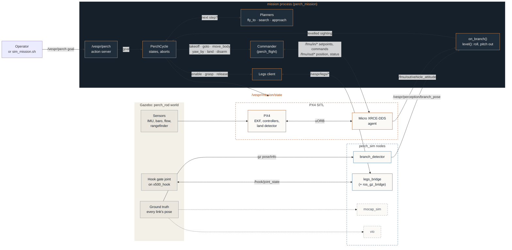

# The system: where the mission's data comes from

Every input to the mission in the sim, the nodes that produce it, and what runs inside the mission process. Read it left to right.

- **Grey:** Gazebo, where everything starts in the sim.
- **Blue:** our `perch_sim` stand-in nodes. Dashed ones (`mocap_sim`, `vio`) run, but the mission doesn't read them yet.
- **Orange:** PX4 SITL.
- **Dark:** the one mission process (`perch_mission`). Commander is its own node, `flight_commander`, but runs in the same process, and the mission calls its methods directly.

Labels on arrows between processes are topics or actions. Labels inside the mission process are method calls.

On the real drone the left side changes, not the topics: a real detector instead of `branch_detector`, the ESP32 legs bridge instead of `legs_bridge`, and PX4 on the Pixhawk instead of SITL.
