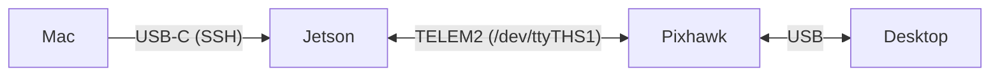

# Hardware Setup: Jetson ↔ Pixhawk



## Commands

Check Pixhawk → Jetson:

```bash
# Terminal 1: start the bridge, leave it running (wait for "session established")
ssh perch@192.168.55.1
MicroXRCEAgent serial --dev /dev/ttyTHS1 -b 921600
```

```bash
# Terminal 2
ssh perch@192.168.55.1
ros2 topic hz /fmu/out/vehicle_attitude          # ~100 Hz = Pixhawk → Jetson works
```

```bash
cd ~/vespr && git pull && colcon build --packages-select perch_flight
source install/setup.bash
ros2 run perch_flight flight_cli
```

Check Jetson → Pixhawk:

```bash
# Jetson
ros2 topic pub -r 10 /fmu/in/offboard_control_mode px4_msgs/msg/OffboardControlMode "{position: true}"
```

```bash
# Desktop QGC → Analyze Tools → MAVLink Console
nsh> listener offboard_control_mode              # should show position: True
```

## One-time setup

### Pixhawk (QGC → MAVLink Console)

```
param set UXRCE_DDS_CFG 102          # client on TELEM2
param set SER_TEL2_BAUD 921600
param set UXRCE_DDS_DOM_ID 16
param show MAV_*_CONFIG              # any = 102? → param set MAV_x_CONFIG 0
param save
reboot
```

### Wiring (TELEM2 → Jetson 40-pin header = `/dev/ttyTHS1`)

| TELEM2 wire | Jetson pin |
|---|---|
| 1 (5V) | not connected |
| 2 (TX) | 10 |
| 3 (RX) | 8 |
| 6 (GND) | 6 |

### Jetson (needs internet)

```bash
# Wi-Fi
nmcli -t -f active,ssid dev wifi | grep '^yes'                 # which Wi-Fi
sudo nmcli dev wifi connect "<name>" password "<password>"

# Serial port + domain ID (log out/in after)
sudo systemctl disable --now nvgetty
sudo usermod -aG dialout $USER
grep -qxF 'export ROS_DOMAIN_ID=16' ~/.bashrc || echo 'export ROS_DOMAIN_ID=16' >> ~/.bashrc

# Micro XRCE-DDS Agent (10–20 min)
sudo apt install -y git cmake build-essential
git clone --depth 1 -b v2.4.3 https://github.com/eProsima/Micro-XRCE-DDS-Agent.git ~/xrce-agent
cmake -S ~/xrce-agent -B ~/xrce-agent/build
cmake --build ~/xrce-agent/build -j$(nproc)
sudo cmake --install ~/xrce-agent/build && sudo ldconfig

# ROS 2 Jazzy
sudo apt install -y software-properties-common curl
sudo add-apt-repository -y universe
sudo curl -sSL https://raw.githubusercontent.com/ros/rosdistro/master/ros.key \
  -o /usr/share/keyrings/ros-archive-keyring.gpg
echo "deb [arch=$(dpkg --print-architecture) signed-by=/usr/share/keyrings/ros-archive-keyring.gpg] http://packages.ros.org/ros2/ubuntu $(. /etc/os-release && echo $UBUNTU_CODENAME) main" \
  | sudo tee /etc/apt/sources.list.d/ros2.list
sudo apt update
sudo apt install -y ros-jazzy-ros-base ros-dev-tools
grep -qxF 'source /opt/ros/jazzy/setup.bash' ~/.bashrc || echo 'source /opt/ros/jazzy/setup.bash' >> ~/.bashrc

# px4_msgs (must match PX4 v1.16)
mkdir -p ~/px4_ws/src
git clone --depth 1 -b release/1.16 https://github.com/PX4/px4_msgs.git ~/px4_ws/src/px4_msgs
cd ~/px4_ws && colcon build
grep -qxF 'source ~/px4_ws/install/setup.bash' ~/.bashrc || echo 'source ~/px4_ws/install/setup.bash' >> ~/.bashrc
```

## Next

Feed mocap to PX4 (`/fmu/in/vehicle_visual_odometry`; `EKF2_EV_CTRL`, `EKF2_HGT_REF` = vision, `EKF2_GPS_CTRL` = 0) so `takeoff` is allowed.
