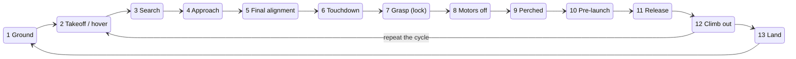

# The perch cycle: mission state machine

Board box 08. See the [index](README.md).

The mission node is a state machine: one state at a time, each with a job, an exit, and an abort.

- The pilot override works in every state and is handled inside the Pixhawk.
- The setpoint heartbeat must keep flowing in every flying state.

## States

| # | State | Phase | What happens | Exit | Abort |
|---|---|---|---|---|---|
| 1 | Ground | rest | Disarmed. Pre-flight: can I hear PX4, camera, legs (and mocap)? | "go" | none |
| 2 | Takeoff / hover | Pixhawk | Arm, enter offboard, setpoint 2 m up. Flies on flow + rangefinder. No perception needed: Cidney's first milestone. | at altitude, stable | hold |
| 3 | Search | Pixhawk | Hover, yaw slowly, wait for `branch_pose` with confidence above threshold. | branch seen N frames | land after timeout |
| 4 | Approach | Pixhawk | First state where vision steers. Target = standoff point from `branch_pose`. Speed capped. | at standoff, aligned | back off, hold |
| 5 | Final alignment | Pixhawk | Rise up under the branch, correcting lateral + yaw from `branch_pose` and the rangefinder. Speed under the gripper's limit. | legs in capture window | climb straight back out |
| 6 | Touchdown | legs | Cut the climb; the cuff closes around the branch. Wait for gripped = true. | gripped | no grip in window → back out |
| 7 | Grasp (lock) | legs | Call `/vespr/legs/grasp`. ESP32 drives the latch to end-of-travel, reports progress. Motors still at low thrust. | action success + gripped | cancel, release, back out |
| 8 | Motors off | legs | Disarm. PX4 stops the ESCs. The whole project in one command. | immediate | none, this is the safest state |
| 9 | Perched | rest | Everything that can power down does. Current here vs state 2 = the energy number. Endurance test = this state, timed. | launch cmd or timer | none |
| 10 | Pre-launch | legs | Arm **while still latched**, bring motors to near-hover thrust. The latch holds you against thrust. Release first and you drop. | armed + thrust | disarm, still latched |
| 11 | Release | legs | Call `/vespr/legs/release`. Cuff opens. | action success | jammed → disarm and sit |
| 12 | Climb out | Pixhawk | Setpoint to standoff altitude, hover. Back to state 2. | at altitude | hold |
| 13 | Land | Pixhawk | PX4 land, disarm. Back to Ground. | on ground | none |

Phase column: on the board, blue = the Pixhawk does the work (the Jetson feeds it targets), orange = the legs do the work (Pixhawk holds gently or is off), grey = at rest. The board colours the states but does not list them individually, so the per-state values here are inferred from the state descriptions.

## Reading the pattern

- The handover is touchdown: "a flight controller flies to a point, then a leg controller takes over."
- There are only three abort moves in the whole table:
  1. **Hold where you are** (early states).
  2. **Climb straight back out** (anything near the branch).
  3. **Stay latched and disarm** (anything on the branch).
- Milestones map onto the table:
  - stable hover = state 2
  - mocap stand-in approach = states 2–5
  - first autonomous landing = states 2–7
  - full cycle = states 2–12
- Open: PX4's pre-arm tilt check in state 10 on an angled branch. The team is starting without tilt first.
