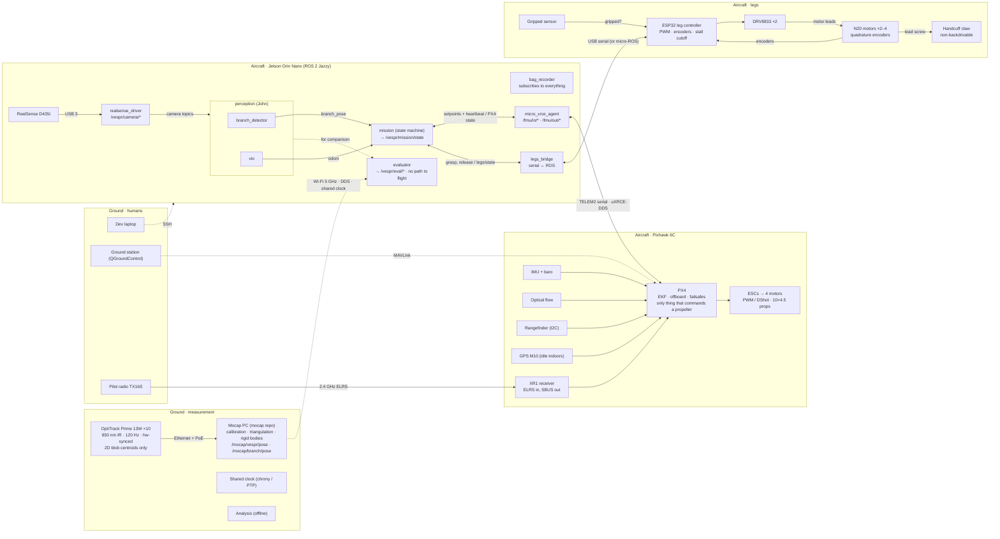

# The system map

Board box 06. See the [index](README.md). Link details (cables, protocols) are in [wiring.md](wiring.md).

On the board, every box is a sticky coloured by owner and every arrow is one connection coloured by chain. Flight and legs are the only chains that reach an actuator. Mocap dead-ends at the evaluator. The radio bypasses everything.

## Diagram

Line style follows the board: solid = flight / legs / override, dashed = measurement and ground.

## Box contents

### Ground · measurement
- **OptiTrack Prime 13W ×10**: 850 nm IR · 120 Hz · hardware-synced · sends 2D blob centroids only.
- **Mocap PC (mocap repo)**: intrinsics · extrinsics · ground plane · triangulation · labeling · rigid bodies. Publishes `/mocap/vespr/pose`, `/mocap/branch/pose`. The only part of that repo that knows about ROS.
- **Shared clock (chrony / PTP)**: serves time to the Jetson over Wi-Fi.
- **Analysis (offline)**: in = rosbags + mocap sessions + PX4 .ulg. Out = accuracy, success rate, failure taxonomy, energy saved, endurance.

### Ground · humans
- **Dev laptop**: run and debug on the Jetson.
- **Ground station (QGroundControl)**: config · telemetry · arm · pull .ulg logs.
- **Pilot radio TX16S**: override switch.

### Aircraft · Jetson Orin Nano (ROS 2 Jazzy)
- **RealSense D435i**: color · depth · camera IMU.
- **realsense_driver**: `/vespr/camera/{color,depth,imu,info}`.
- **perception (John)**: `branch_detector` → `perception/branch_pose`; `vio` → `perception/odom`.
- **mission (state machine)** (Cidney): reads branch_pose, odom, PX4 state, rangefinder, legs/state. Sends setpoints + heartbeat, arm / disarm. Calls grasp, release. Publishes `/vespr/mission/state`. **The only node with arrows to actuators.**
- **evaluator** (Rushav): vision vs mocap, relative pose first → `/vespr/eval/*`. No path to flight.
- **bag_recorder** (Dom): subscribes to everything → rosbag.
- **micro_xrce_agent**: `/fmu/out/*`, `/fmu/in/*`.
- **legs_bridge**: serial ↔ ROS translator. grasp / release actions, `/vespr/legs/state`.

### Aircraft · Pixhawk 6C (PX4)
- **PX4**: EKF on IMU + flow + rangefinder (+VIO later). Offboard mode · failsafes · pre-arm checks. Only thing that ever commands a propeller. Publishes best effort (QoS trap).
- **XR1 receiver**: ELRS in, SBUS out.
- **ESCs → 4 motors**: PWM / DShot, 10×4.5 props.
- **Sensors**: IMU + baro (built in), optical flow (indoor hold), rangefinder (I2C, altitude), GPS M10 (idle indoors).

### Aircraft · legs
- **ESP32 (leg controller)**: PWM out, encoder interrupts, stall / end-stop cutoff. Commands: grasp · release · status. Wi-Fi + BT off (2.4 GHz).
- **DRV8833 ×2**: PWM in from ESP32, dual drivers.
- **N20 motors ×2–4**: with quadrature encoders, drive the handcuff latch.
- **Gripped sensor**: is the branch in the claw?
- **Handcuff claw**: top-mounted, closes like a cuff. Non-backdrivable drive, zero power to hold.
