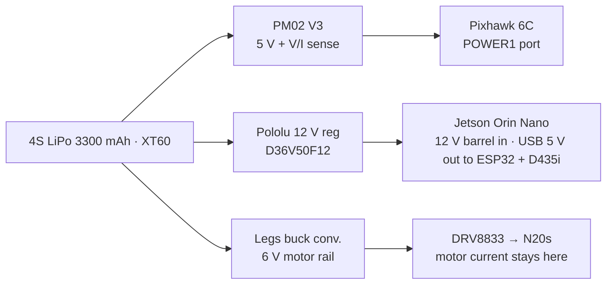

# Wiring and protocols

Board box 03, plus the power rails from box 10. See the [index](README.md).

Every pair that talks has a physical link (the phone line) and a protocol (the language on the call). One row per arrow on the [system map](system-map.md).

## Links

### Flight chain

| From | To | Cable / radio | Protocol | Carries |
|---|---|---|---|---|
| RealSense D435i | realsense_driver | USB 3 (blue port, short cable) | realsense-ros | color, depth, camera IMU |
| realsense_driver | perception | ROS 2 topics | `/vespr/camera/*` | color + depth images, camera_info, imu |
| branch_detector | mission | ROS 2 topic | `/vespr/perception/branch_pose` | branch position + axis, drone frame |
| vio | mission | ROS 2 topic | `/vespr/perception/odom` | drone position + velocity |
| mission | micro_xrce_agent | ROS 2 topics | `/fmu/in/trajectory_setpoint`, `offboard_control_mode`, `vehicle_command` | go-here target (also the heartbeat), arm / disarm / mode |
| micro_xrce_agent | mission | ROS 2 topics, subscribe **BEST EFFORT** | `/fmu/out/vehicle_local_position`, `vehicle_status`, `distance_sensor`, `battery_status` | where PX4 thinks it is, armed / mode, rangefinder, battery |
| micro_xrce_agent | PX4 (both ways) | Serial: Pixhawk TELEM2 to Jetson UART, 921600 baud | uXRCE-DDS | all `/fmu/*` topics as bytes |
| PX4 | ESCs / motors | 4 signal wires | PWM or DShot | throttle per motor |
| IMU, flow, rangefinder, GPS | PX4 | on-board / UART / I2C / GPS port | PX4 drivers | attitude, ground velocity, height (GPS idle indoors) |
| vio *(later)* | micro_xrce_agent | ROS 2 topic | `/fmu/in/vehicle_visual_odometry` | vision estimate fused into the EKF (stage 3) |

### Legs chain

| From | To | Cable / radio | Protocol | Carries |
|---|---|---|---|---|
| mission | legs_bridge | ROS 2 action | `/vespr/legs/grasp`, `/vespr/legs/release` | goal, feedback, result, cancel |
| legs_bridge | mission | ROS 2 topic | `/vespr/legs/state` | latch position, gripped, motor current |
| legs_bridge | ESP32 (both ways) | USB (also powers the ESP32) | plain text serial, or micro-ROS (undecided) | grasp / release / status |
| ESP32 | DRV8833 ×2 | 2 pins per channel | PWM, 20 kHz | speed + direction |
| DRV8833 | N20 motors | motor leads | - | motor current, from the legs rail |
| N20 encoders | ESP32 | 2 pins per motor, 3.3 V | quadrature | latch position |
| Gripped sensor | ESP32 | 1 pin | GPIO | branch in claw: yes / no |
| N20 | Handcuff claw | mechanical | non-backdrivable drive | closes and locks the cuff |

### Measurement chain

| From | To | Cable / radio | Protocol | Carries |
|---|---|---|---|---|
| OptiTrack cameras ×10 | Mocap PC | Gigabit Ethernet + PoE, dedicated NIC | camera SDK, discovery on UDP 13013 | synced frames, 2D blob centroids at 120 Hz |
| Mocap PC | evaluator | Wi-Fi 5 GHz (off the ELRS band) | ROS 2 / DDS, same `ROS_DOMAIN_ID` | `/mocap/vespr/pose`, `/mocap/branch/pose` |
| Mocap PC | Jetson | Wi-Fi | chrony or PTP | one clock for both logs |
| perception | evaluator | ROS 2 topics | `/vespr/perception/*` | the vision estimate, for comparison only |

### Override chain

| From | To | Cable / radio | Protocol | Carries |
|---|---|---|---|---|
| Pilot radio TX16S | XR1 receiver | 2.4 GHz radio | ELRS | sticks, override switch, kill switch |
| XR1 receiver | PX4 | 1 wire into RC IN | SBUS (set the XR1 to SBUS, not CRSF) | all channels; PX4 obeys this over the Jetson |

### Ground / dev

| From | To | Cable / radio | Protocol | Carries |
|---|---|---|---|---|
| Ground station | PX4 | USB on the bench, Wi-Fi via Jetson in flight | MAVLink | config, telemetry, arm, .ulg logs |
| Dev laptop | Jetson | Wi-Fi | SSH | run and debug |

## Power rails

One battery, three isolated rails, all grounds tied.

Three rails so a motor spike cannot brown out the Jetson or the Pixhawk. The ESP32 is powered by the Jetson's USB; the motors are not.
