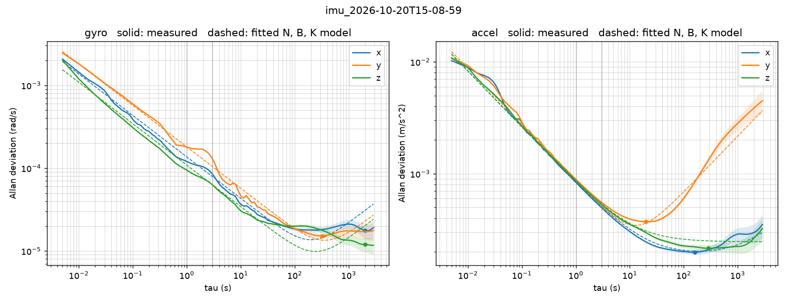

# D435i IMU characterization: overnight run 1 (2026-10-20)

Allan variance characterization of the D435i's accelerometer and gyroscope, for the noise
parameters of the state estimator. Every number here comes from the files in this folder:

| File | What it is |
|---|---|
| [`imu_2026-10-20T15-08-59.json`](imu_2026-10-20T15-08-59.json) | the logger's sidecar: camera, options, final report |
| [`imu_2026-10-20T15-08-59.status.log`](imu_2026-10-20T15-08-59.status.log) | startup lines, one status line a minute, final report |
| [`imu_2026-10-20T15-08-59_allan.json`](imu_2026-10-20T15-08-59_allan.json) | `imu_allan` output: grid, per-axis N, B, K, curves |
| [`imu_2026-10-20T15-08-59_allan.png`](imu_2026-10-20T15-08-59_allan.png) | the Allan deviation plot |

**Raw data (not in git, 1.46 GB):** `~/vespr_recordings/imu/imu_2026-10-20T15-08-59.csv` on the
Jetson (`perch`, user `perch`). The analysis ran on a copy of that file.

## Setup

| | |
|---|---|
| Camera | Intel RealSense D435i, serial 348522076012, firmware 5.15.1.55, on USB 3.2 |
| Host | Jetson `perch`, librealsense 2.58.4 built from source, Python 3.12.3 |
| Logger | `perch_eval.imu_log` at commit 437cddd, clean tree |
| IMU calibration | `rs-imu-calibration` on 2026-10-20, written to the camera; motion correction on (1.0) |
| Streams | accel and gyro at 200 Hz requested; with `--depth`: depth z16 and left IR y8, 848x480 at 30 fps, emitter on (laser power 150) |
| Clock | `global_time_enabled` 0 on both sensors: `ts_ms` in `hardware_clock` throughout |
| Mount | on its back, lens up, taped to a steel plate on a solid table |
| Room | undisturbed overnight; room temperature not logged |
| Warm-up | 20 min, streaming, nothing written (ASIC 29 → 36 °C, projector 24 → 32 °C) |
| Logging | 8 h 00 min: 15:29:00 to 23:29:01; ASIC 36–41 °C, projector 32–35 °C |
| Samples | accel 5 827 479, gyro 5 772 490 |

**Calibration.** The unit shipped uncalibrated, with identity sensitivity. After calibration
the camera reports an accel scale/misalignment matrix with diagonal 1.0072, 1.0067, 1.0047 and
offsets 0.0140, −0.1463, −0.0811 m/s²; the gyro keeps identity scale with biases of −5.6e-5,
−5.5e-5, −2.9e-5 rad/s. The camera's `noise_variances` and `bias_variances` read 0 for both
sensors: the calibration does not set them, so estimator noise values must come from this
report, not from the camera.

## Clock findings

- **`ts_ms` is a 32-bit microsecond counter and wraps.** Each stream stepped back six times by
  −4294.962 s, which is 2^32 µs (4294.967 s) less one sample period, about every 71.6 min. The
  logger at 437cddd did not unwrap and counted each wrap as a clock discontinuity; the
  analysis unwraps (6 wraps per stream, one continuous segment of 8.00 h for each). The logger
  now unwraps too.
- **Rates are measured, not nominal.** Median period 4943 µs, **202.31 Hz** for accel, and
  4990 µs, **200.40 Hz** for gyro, with 200 Hz requested. In the cold 60 s dry run the accel
  period was 4923 µs (203.1 Hz): the rate depends on temperature.
- **Samples lost inside the camera.** 15 intervals of exactly two periods (12 accel, 3 gyro),
  each with consecutive frame numbers across it: one sample missing each time, invisible to
  `frame_number` (0 frame-number gaps on either stream). The analysis bridged them by
  interpolation (12 and 3 samples out of 5.8 million).
- **Host arrival jitter.** Around the linear fit of host time against camera time, the residual
  is 9.25 ms rms (accel) and 6.01 ms rms (gyro) on a 5 ms stream. `host_ns` is not usable as a
  time base; the analysis uses only `ts_ms`.
- **Drift between host and camera clocks.** −139 ppm in the 60 s dry run; overnight −49.96 ppm
  (accel fit, 3336 s segment) and −80.83 ppm (gyro fit, 4295 s segment). Those fits were on the
  longest stretch between the old logger's spurious discontinuities, not the whole run. The
  wrap spacing agrees: by host time, consecutive wraps were 4294.60–4294.69 s apart against
  4294.967 s on the camera clock, −65 to −85 ppm on both streams.

## Results per axis

N is noise density, B bias instability, K rate/acceleration random walk. N and K come from one
weighted fit of σ²(τ) = N²/τ + 0.441·B² + K²·τ/3 to the whole usable curve; error bars are the
fit's 1σ, inflated for the correlation between adjacent Allan points. B is the curve's minimum
divided by 0.664; `imu_allan` gives B no error bar. τ ranges from 0.005 s to 2880 s (a tenth of
the run).

**Gyro**: N in rad/s/√Hz, B in rad/s, K in rad/s²/√Hz

| Axis | N ± 1σ | B | B floor | K ± 1σ | K | Model fit residual |
|---|---|---|---|---|---|---|
| x | 1.367e-4 ± 5.2e-8 | 2.651e-5 (min σ 1.760e-5 at τ = 2038 s) | **not resolved** | 1.185e-6 ± 7.1e-8 (6.0 %) | resolved | 17.0 % |
| y | 1.807e-4 ± 6.8e-8 | 2.284e-5 (min σ 1.516e-5 at τ = 322 s) | resolved | 8.700e-7 ± 7.6e-8 (8.7 %) | resolved | 12.4 % |
| z | 1.087e-4 ± 4.2e-8 | 1.804e-5 (min σ 1.198e-5 at τ = 2038 s) | **not resolved** | 7.756e-7 ± 5.4e-8 (6.9 %) | resolved | 31.6 % |

**Accel**: N in m/s²/√Hz, B in m/s², K in m/s³/√Hz

| Axis | N ± 1σ | B | B floor | K ± 1σ | K | Model fit residual |
|---|---|---|---|---|---|---|
| x | 8.237e-4 ± 3.2e-7 | 2.986e-4 (min σ 1.983e-4 at τ = 161 s; model 2.773e-4) | resolved | 7.601e-6 ± 2.1e-6 (28 %) | resolved | 10.0 % |
| y | 8.710e-4 ± 3.3e-7 | 5.607e-4 (min σ 3.723e-4 at τ = 20 s) | resolved | 1.184e-4 ± 1.6e-6 (1.3 %) | resolved | 14.1 % |
| z | 8.284e-4 ± 3.2e-7 | 3.241e-4 (min σ 2.152e-4 at τ = 286 s; model 3.704e-4) | resolved | — | **not resolved**: the model needs no random-walk term | 8.1 % |

N's error bars are under 0.04 %. As cross-checks, `imu_allan` also gives a fit of N over the
−1/2 slope region and the raw σ at τ = 1 s. For accel both agree with N within 6 % on every
axis. For gyro the slope-region fit agrees within 10 %, but σ(1 s) is 12–13 % below N on x and
z (gyro x: N 1.367e-4, slope fit 1.463e-4, σ(1 s) 1.198e-4). All values are in the JSON. The fit residual is the rms of log10(model / measured)
as a percentage.

## Summary: max over axes

These are the conservative single values for an estimator config.

| | N (noise density) | B (bias instability) | K (random walk) |
|---|---|---|---|
| Gyro | 1.807e-4 rad/s/√Hz | 2.651e-5 rad/s (from x, floor not resolved) | 1.185e-6 rad/s²/√Hz |
| Accel | 8.710e-4 m/s²/√Hz | 5.607e-4 m/s² | 1.184e-4 m/s³/√Hz (from y; see caveats) |

## Gravity check

The mean accel over the 8 h was (0.0898, 0.0034, 9.7897) m/s², magnitude **9.790 m/s²**. At
calibration it read 9.805 m/s². The difference is −0.015 m/s² (−0.15 %).

## Caveats

- **The model fits the real curves less well than it fits synthetic data.** The fit residuals
  are 8–32 % here. On the self-test's synthetic IMU (white noise plus random walk, no flicker)
  they are 1–3 %. The real curves have structure the three-term model does not capture, so read
  B and K with that in mind.
- **Accel y random walk is 15x accel x** (1.184e-4 against 7.601e-6 m/s³/√Hz), and its curve
  turns up from τ ≈ 20 s. Nothing about the y axis should make it 15x worse. Slow movement or
  tilt of the camera would look like this. It sets the accel K in the summary.
- **The gyro floor on x and z is not resolved**: their minimum is at the longest usable τ
  (2038 s), so B there is an upper bound on the floor, not a measurement. The gyro K values
  are flagged resolved, but in the plot the measured gyro curves stay flat above τ ≈ 100 s,
  while the dashed model rises. Treat gyro K as weakly determined.
- **Environment suspected** for the accel y random walk and the unresolved gyro floor:
  temperature cycling (the ASIC reading moved between 36 and 41 °C, in 228 one-degree steps
  over the 8 h) and creep of the taped mount. Room temperature was not logged.
- **N is solid**: its error bars are under 0.04 %, it is set by the short-τ end of the curve
  where the statistics are best, and the accel cross-checks agree within 6 %. The gyro's
  σ(1 s) cross-check sits 12–13 % below N on x and z, where the gyro curves wiggle between
  τ = 1 and 3 s; the conservative choice is the fitted N, as in the summary.
- **A second run would tighten B and K**: a rigid mount (clamped or bolted, not taped) and room
  temperature logged alongside the camera's.
- The logger that recorded this run (437cddd) reported 27 clock discontinuities (wraps and
  two-period steps). Its drift fits cover single segments between them. The analysis does not
  depend on the logger's report: it reads the raw CSV.
