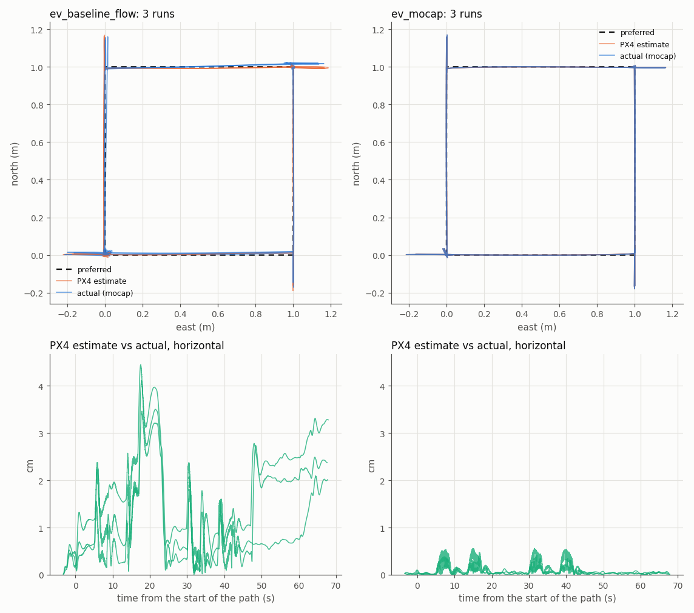
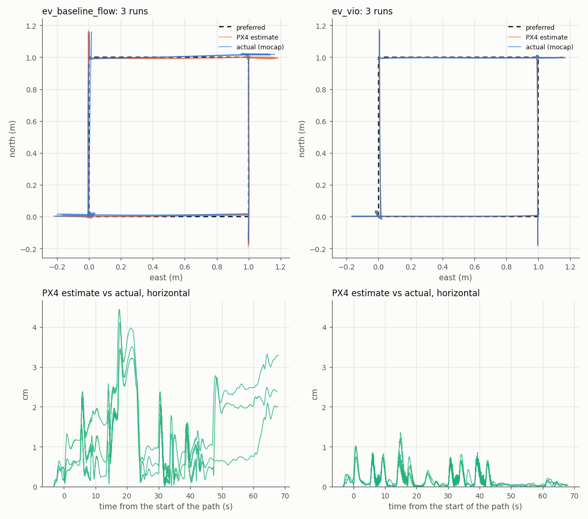
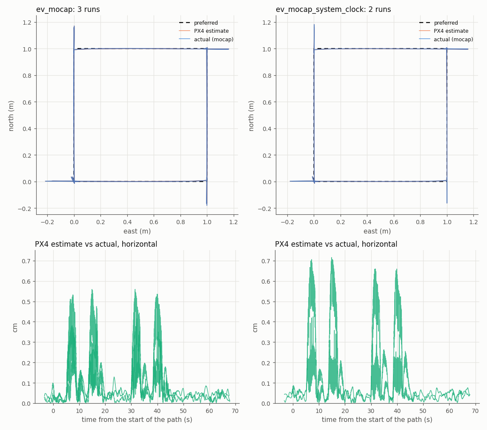

# external_bridge in the sim: flying on mocap and VIO (2026-11-15)

The flight accuracy path (`flight_path`: up, a 1 m square, a 90° turn, a 0.5 m climb and descent, at 1 m altitude), flown in the sim on four position sources. Design: [docs/design/external_bridge.md](../../../docs/design/external_bridge.md).

| Set | PX4 flies on | Runs | Command |
|---|---|---|---|
| `baseline_flow` | optical flow + rangefinder + compass (as before) | 3 | `RUNS=3 flight_accuracy_runs.sh` |
| `mocap` | `external_bridge` from `mocap_sim`, flow off (`EV=mocap`) | 3 | `EV=mocap RUNS=3 ...` |
| `vio` | `external_bridge` from `fake_vio`, flow on (`EV=vio`) | 3 | `EV=vio RUNS=3 ...` |
| `mocap_system_clock` | as `mocap`, but each pose re-stamped with the system clock, as the real mocap PC stamps: the real drone's clock path | 2 | a copy of the runner using `perch_flight/test/system_clock_restamp.py` |

All with `mocap_sim` and `fake_vio` perfect (no noise or drift), altitude 1.0 m, climb 0.5 m, turn 90°, wait 10 s, GPS off. Every run flew the whole path.

## What PX4 fused

Share of `/fmu/out/estimator_status_flags` samples with each flag on, during the recording:

| Set | `cs_ev_pos` | `cs_ev_hgt` | `cs_ev_yaw` | `cs_ev_vel` | `cs_opt_flow` | `cs_mag_hdg` | `cs_baro_hgt` |
|---|---|---|---|---|---|---|---|
| `baseline_flow` (run 1) | 0 % | 0 % | 0 % | 0 % | 100 % | 67 % | 100 % |
| `mocap` (runs 1-3) | 100 % | 100 % | 100 % | 0 % | 0 % | 0 % | 100 % |
| `vio` (run 1) | 98 % | 98 % | 98 % | 98 % | 100 % | 0 % | 100 % |
| `mocap_system_clock` (runs 1-2) | 100 % | 100 % | 100 % | 0 % | 0 % | 0 % | 100 % |

The bridge logged, in each set: `mocap` and `vio`, "Input stamps are on PX4's clock already (sim, Gazebo time)"; `mocap_system_clock`, "Input stamps are on the system clock (real drone)", then about 5 s of "No /fmu/out/timesync_status from PX4 yet: not sending", then zeroed and sent.

## Flow vs mocap

*Left: on flow (3 runs). Right: on mocap through the bridge (3 runs). Top: the flight from above; dashed is the plan, orange is where PX4 thinks the drone is, blue is where it actually was (mocap). Bottom: how far PX4's estimate is from the actual position over the flight.*

| Measured with mocap | `baseline_flow` | `mocap` |
|---|---|---|
| PX4 estimate vs actual while holding, mean / max (cm) | 1.5 / 4.4 | 0.1 / 0.5 |
| Actual vs the plan while holding, mean / max (cm) | 3.9 / 21.4 | 3.4 / 21.5 |
| Actual off the line while moving, mean (cm) | 3.0 | 1.1 |
| Actual altitude while holding, mean (cm) | -2.4 | -0.0 |
| Heading, actual vs PX4 estimate, mean / max (deg) | -0.1 / 1.6 | +0.0 / 0.3 |
| Settled within 5 cm after a step (takeoff not counted) | 23 of 24 | 24 of 24 |
| Distance from the target at the end of a hold, mean (cm) | 3.2 | 1.0 |

## Flow vs VIO

| Measured with mocap | `baseline_flow` | `vio` |
|---|---|---|
| PX4 estimate vs actual while holding, mean / max (cm) | 1.5 / 4.4 | 0.1 / 0.8 |
| Actual vs the plan while holding, mean / max (cm) | 3.9 / 21.4 | 3.2 / 17.8 |
| Actual off the line while moving, mean (cm) | 3.0 | 1.1 |
| Actual altitude while holding, mean (cm) | -2.4 | -0.1 |
| Heading, actual vs PX4 estimate, mean / max (deg) | -0.1 / 1.6 | -0.0 / 0.3 |
| Settled within 5 cm after a step (takeoff not counted) | 23 of 24 | 24 of 24 |
| Distance from the target at the end of a hold, mean (cm) | 3.2 | 1.0 |

## Gazebo stamps vs system-clock stamps (the real drone's clock path)

| Measured with mocap | `mocap` | `mocap_system_clock` |
|---|---|---|
| PX4 estimate vs actual while holding, mean / max (cm) | 0.1 / 0.5 | 0.1 / 0.6 |
| Actual vs the plan while holding, mean / max (cm) | 3.4 / 21.5 | 3.3 / 18.2 |
| Actual off the line while moving, mean (cm) | 1.1 | 1.1 |
| Actual altitude while holding, mean (cm) | -0.0 | -0.0 |
| Heading, actual vs PX4 estimate, mean / max (deg) | +0.0 / 0.3 | -0.0 / 0.4 |
| Settled within 5 cm after a step (takeoff not counted) | 24 of 24 | 16 of 16 |
| Distance from the target at the end of a hold, mean (cm) | 1.0 | 1.0 |

## Not covered

- Noise, drift, latency or dropped samples in `mocap_sim` / `fake_vio`: all runs were perfect input.
- A start heading other than the world's x: every run spawned facing 0° (the bridge logged "heading -0.0 deg" / "0.0 deg"), so the 45° check in the design's test plan is still to do.
- A sim reset or bridge restart mid-flight.

## Files

| File | What it is |
|---|---|
| `external_bridge_2026-11-15/*.png` | the before/after plots above (`flight_accuracy --before`) |
| `external_bridge_2026-11-15/<set>.json` | every number for each set (`flight_accuracy.json`) |

**Raw data (not in git):** bags, PX4 ulogs and node logs in `~/vespr_recordings/flight_accuracy/ev_{baseline_flow,mocap,vio,mocap_system_clock}/` on the sim machine.
