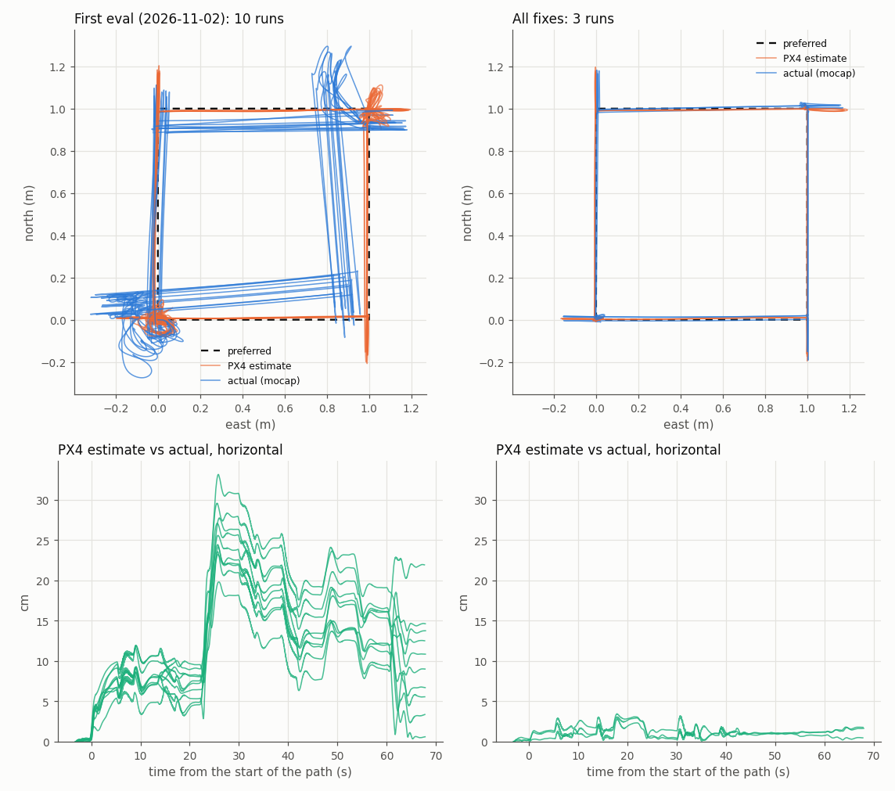

# Flight accuracy in the sim: what was wrong, and the fixes (2026-11-02 to 2026-11-05)

The first flight accuracy eval ([flight_accuracy_2026-11-02.md](flight_accuracy_2026-11-02.md)) found the sim drone 10 to 35 cm from where PX4 thought it was. This page covers what caused that and how each fix changed the flight.

- **Summary**: the short version, for people.
- **Reference**: the detail (symptoms, causes, how each was found, dead ends, tools). It's for an engineer or AI debugging a similar problem later.

## Summary

**Before:** the drone flew a square 10 to 35 cm away from where PX4 thought it was. It never settled within 5 cm of a target.

**After:** PX4's estimate is within about 1 cm of the actual position (3.5 cm at worst), and the drone settles within 5 cm after every move.



*Left: the first eval (10 runs). Right: everything fixed (3 runs). Top: the flight from above; dashed is the plan, orange is where PX4 thinks the drone is, blue is where it actually was (mocap). Bottom: how far PX4's estimate is from the actual position over the flight.*

| Measured with mocap | First eval | All fixes |
|---|---|---|
| PX4 estimate vs actual, while holding (mean / max) | 14.1 / 33.2 cm | **1.2 / 3.5 cm** |
| Actual vs the plan, while holding (mean) | 15.0 cm | **3.6 cm** |
| Actual off the line while moving (mean) | 12.8 cm | **2.8 cm** |
| Settled within 5 cm after a move | 1 of 80 | **24 of 24** |
| Distance from the target at the end of a hold (mean) | 15.4 cm | **2.7 cm** |

**The fixes are all to the sim, not to PX4's flight code.** The sim was feeding PX4 wrong information in three ways:

| # | Problem | Fix | What it changed (image) |
|---|---|---|---|
| 1 | PX4 saved magnetometer offsets from earlier sim runs and loaded them next time. That turned its heading by up to 9°, so the square came out rotated | `run_sim.sh` starts PX4 from clean settings every run | Heading error from up to 9° to within 1°. The square is no longer rotated ([image](flight_accuracy_fixes_2026-11-05/1_clean_params.png)) |
| 2 | PX4 didn't know the sim's magnetic declination (−2.6°), so its compass was 2.6° off. Every move drifted a few cm sideways | `EKF2_MAG_DECL -2.6` in the airframe, plus the flow sensor's and rangefinder's positions | Sideways drift per 1 m move from 3–6 cm to 0.5–2 cm. Small in the totals ([image](flight_accuracy_fixes_2026-11-05/2_declination.png)) |
| 3 | The sim's optical flow sensor read **spinning** as sideways motion, so the drone drifted 7–17 cm in every turn | Our own flow sensor plugin that separates spinning from moving | Corner loops gone; estimate error 11.6 → 9.4 cm ([image](flight_accuracy_fixes_2026-11-05/3_flow_rotation.png)) |
| 4 | The same sensor read **climbing** (the floor image shrinking) as sideways motion, so the drone slid 7–10 cm during takeoff | The same plugin also separates zoom | Estimate error 8.8 → 1.2 cm, the biggest single step ([image](flight_accuracy_fixes_2026-11-05/6_flow_zoom.png)) |

**Tried, and little or no help:**
- Flow delay 0 ms: no change ([image](flight_accuracy_fixes_2026-11-05/4_flow_delay.png)); kept because it matches the sim.
- Waiting 30 s before takeoff: about 1 cm ([image](flight_accuracy_fixes_2026-11-05/5_wait.png)); the eval now waits 10 s.

**What's left** is PX4's flight control, not its estimate:
- It overshoots by 16–18 cm when stopping after a 1 m move.
- It runs about 6 cm behind while moving.
- It climbs slowly at takeoff.

That's PX4 tuning, a separate job.

**What it means for the real drone:**
- These were sim problems. The real drone has a real compass and a real flow sensor, which can be wrong in their own ways: indoor steel, motor currents, a bad calibration, the lab's declination.
- The same eval now runs on the real drone with mocap (`REAL=1`), so we can measure rather than guess.
- Every number here is from 3 runs per set (10 for the first eval). Before using "all fixes" as a baseline, fly the full 10 runs.

**Testing the next change:** fly a set, change one thing, then fly again with `BEFORE=<the first set>`. The eval writes a before/after image like the ones above ([how](../../../docs/design/flight_accuracy.md#running-it)).

## Reference

Detail for debugging a similar problem: what each error looked like in the eval, what caused it, how it was found, and what it means for the real drone. Unless stated otherwise, every set has 3 runs of the standard path. Recordings (not in git) are in `~/vespr_recordings/flight_accuracy/`. The image for each fix is in [flight_accuracy_fixes_2026-11-05/](flight_accuracy_fixes_2026-11-05/).

### How to dig, in the order that worked

1. **Split the error first.** The eval separates estimation error (actual − PX4 estimate) from control error (estimate − setpoint). In the first eval, 90 % of the total was estimation, so the work went into the estimate rather than tuning.
2. **Compare each stage of the estimate with the truth, in time.** Check the sensor (flow converted to velocity), then PX4's velocity, then PX4's position, each against true motion. Split by flight phase: holding, moving, turning, climbing, the first seconds after lift-off. Errors that build only during one kind of motion, and undo themselves on the reverse motion, point at a sensor model.
3. **Look at the truth directly, not only the eval.** The eval lines mocap up with PX4 at rest, so an error PX4 already has at rest (a constant heading offset) is invisible to it. In the sim, PX4's ulog has Gazebo's truth. See the tools below.
4. **Change one thing per set, fly 3 runs, compare before/after**:
   ```bash
   BEFORE=<previous set> RUNS=3 src/perch_eval/scripts/flight_accuracy_runs.sh
   ```
   In the sim, runs repeat to within about 1 cm, so 3 runs are enough to see a 2 cm change.
5. **Rule out other causes with variant paths:**
   - `TURN=0`: no yaw.
   - `CLIMB=0`, or `ALTITUDE=2`: whether the path crosses PX4's 1.5 m heading reset.
   - `GPS=1`: another heading and position source.
   - `WAIT=30`: time on the ground.

### Tools and signals

| What | Where |
|---|---|
| Truth in the sim, without the eval's alignment | ulog `vehicle_local_position_groundtruth`, `vehicle_attitude_groundtruth`. The runner copies each run's ulog to `run_NN.logs/`. Read it with pyulog |
| Heading resets | `heading_reset_counter` in `vehicle_local_position` (ulog or `/fmu/out/vehicle_local_position`) |
| Which sources EKF2 fuses, heading "good" | `/fmu/out/estimator_status_flags` (recorded by the runner): `cs_mag_hdg`, `cs_mag_3d`, `cs_opt_flow`, `cs_rng_hgt`, `cs_mag_aligned_in_flight`; `heading_good_for_control` |
| Flow readings and their fit | ulog `vehicle_optical_flow` (rad, integrated); `estimator_aid_src_optical_flow` (innovations). Flow × height ÷ dt = ground speed, to compare with true velocity |
| Raw magnetometer | ulog `sensor_mag`; against `vehicle_attitude_groundtruth` it gives the sim's field direction and declination |
| PX4's saved parameters (sim) | `PX4-Autopilot/build/px4_sitl_default/rootfs/parameters.bson`; `param show CAL_MAG*` at `pxh>` |

**Pitfalls:**
- `estimator_states` doesn't carry horizontal position; states 7 and 8 read 0 in flow-only flight.
- PX4's output position (`vehicle_local_position`) integrates velocity but is continuously pulled toward the main filter's position. When it stops following its own velocity, look at what the main filter fused.
- A runner check like `pgrep -f bin/px4`, run from a command line that itself contains "bin/px4", matches itself.

### 1. Saved magnetometer offsets: the heading slip at turns and the bad 1.5 m reset

**Symptom.** The square came out rotated. PX4's heading drifted −2 to −4° away from the truth during each +90° turn and returned on the −90° turn. Then, as the drone first reached about 1.5 m, PX4 reset its heading by about +4.2°, which made the error worse (to −9°). With GPS on, the reset was about +7.4°. Before the reset, `heading_good_for_control` was false for most of the flight.

**How it was found:**
- **Sets A, B and C** (2026-11-03). A flew at 1 m with no climb, B at 2 m, C with GPS.
  - The reset happened exactly when the drone first reached 1.43 to 1.49 m, and never without that climb. It is EKF2's deliberate in-flight mag alignment (`mag_anomalies_max_hagl` 1.5 m, `checkHaglYawResetReq` in `mag_control.cpp`), which also switches from `cs_mag_hdg` to `cs_mag_3d`.
  - The turn slip happened in every set, including after the reset (B). So the reset and the slip were separate, and the reset itself was not the bug: what it read was.
- **Then PX4's saved parameters.**
  - The sim keeps `parameters.bson` between runs. It held `CAL_MAG0_XOFF/YOFF/ZOFF` = −0.012, −0.012, +0.035 gauss, which PX4 had learned in earlier flights and saved on disarm (`VehicleMagnetometer::UpdateMagCalibration`).
  - Gazebo's magnetometer has no bias, so these offsets acted as a fake magnet fixed to the drone (hard iron).
  - That gives a heading error that depends on which way the drone faces, so it changes at a turn and undoes itself on the turn back. 0.017 G of horizontal offset against Earth's 0.22 G horizontal field gives up to about ±4°.

**Fix.** `perch_sim/scripts/run_sim.sh` deletes `parameters.bson` and `parameters_backup.bson` before every start; `KEEP_PARAMS=1` keeps them.

**Effect (set D vs the first eval; [image](flight_accuracy_fixes_2026-11-05/1_clean_params.png)).** Heading error went from up to −9° to within ±1°. The 1.5 m reset went from +4.2° to about 0.1°. The square was no longer rotated, but it was still shifted by about 10 cm (fixes 2 to 5).

**Real drone.** This cause is sim-only. The real drone can show the same signature (rotated path, slip at turns, a jump at 1.5 m) from:
- indoor steel or equipment
- motor and battery currents
- steel in the hook or legs
- a bad or outdated magnetometer calibration. PX4 learns and saves these offsets on real hardware too.

The eval with mocap measures it. If the heading is off by more than a degree or two, consider heading from VIO or mocap.

**General lesson.** Sim runs weren't independent: anything PX4 saves (calibrations, learned values, parameters set by hand) carried into the next run. The airframe comment claiming otherwise was wrong.

### 2. Magnetic declination: a constant 2.6° heading offset

**Symptom.**
- After fix 1, the eval showed a correct heading, yet every 1 m move drifted 3 to 6 cm sideways, and the square was shifted.
- Compared directly with Gazebo's truth (ulog), PX4's heading was +2.6° off for the whole flight.
- The eval can't see that, because it lines mocap up with PX4's heading at rest.

**Cause.**
- Without GPS, PX4 can't look the declination up (WMM), so it uses `EKF2_MAG_DECL`, which was 0.
- The sim's field has a declination of −2.6°. That was measured from `sensor_mag` against `vehicle_attitude_groundtruth`.
- Gazebo's sign is the opposite of the real declination at the world's latitude and longitude (+3.4°).
- The world file's own magnetic field line (14.6°) is ignored by gz-sim 8's magnetometer.

**Fix.** `EKF2_MAG_DECL -2.6` in `perch_sim/airframes/4920_gz_x500_hook`.

**Effect (set E vs D, against Gazebo's truth; [image](flight_accuracy_fixes_2026-11-05/2_declination.png), though the eval can't show the heading part).**
- The heading offset went from +2.6° to within ±0.4°.
- Sideways drift per 1 m move went from 3 to 6 cm to 0.5 to 2.3 cm.
- The overall eval numbers barely moved, because fixes 4 and 5 were larger.

**Real drone.** Flying indoors without GPS, set `EKF2_MAG_DECL` to the lab's declination (WMM, for the lab's location), or take heading from another source. 2.6° moves the drone about 4.5 cm sideways per metre.

### 3. Sensor positions and the ground reading: small

These went into the same set (E) as fix 2:
- `EKF2_OF_POS_X 0.03` and `EKF2_OF_POS_Z 0.052`: the flow sensor's position.
- `EKF2_RNG_POS_Z 0.057`: the rangefinder's position.
- `EKF2_MIN_RNG 0.17`: what the rangefinder reads on the ground.

The values come from `config/x500_hook.yaml` and the sim. The effect was small: height a little better, and no change to the turn drift. A hypothesis that the centre of mass was 12 cm off (the drone swinging round it in turns) was wrong; the model's centre of mass is 4 mm from `base_link`.

**Real drone.** Set these to the measured positions. They matter more if the flow sensor is far from the centre.

### 4. The sim's flow sensor reads rotation as motion: the drift in turns

**Symptom.**
- During each 90° turn, at about 30°/s, the actual drone moved 7 to 17 cm while PX4 thought it held still. The opposite turn moved it back.
- There were loops at the turn corners in the top view.
- The size varied from run to run, but the direction was always the same.

**How it was found.**
- Flow converted to ground speed tracked the truth outside turns, and separated from it only during turns.
- The flow error, binned by yaw rate:

  | Yaw rate | Flow error |
  |---|---|
  | 0 to 2°/s | 1.7 cm/s |
  | 2 to 10°/s | 2.7 cm/s |
  | 10 to 20°/s | 7.0 cm/s |
  | 20 to 40°/s | 7.9 cm/s |

- PX4 believed the flow, held what it thought was its position, and so moved the real drone.

**Cause.**
- PX4's Gazebo flow sensor (the `OpticalFlowSystem` gz plugin, with `OpticalFlowOpenCV` from PX4-OpticalFlow) tracks about 20 floor features (KLT) and reports the mean of their image displacements.
- When the camera yaws, every feature moves round the image centre. The mean cancels only if the features happen to be spread evenly round the centre, which they usually aren't.
- EKF2 compensates flow for body rates about x and y, but expects no flow from yaw for a sensor at the centre. Nothing removes this error.
- No upstream report or fix was found (a search of the plugin's and PX4-OpticalFlow's history, 2026-11-05).
- Separately, PX4 PR #29306 (October 2026) fixes the plugin dropping every other frame. Our PX4 (v1.16) predates it. On our speckled floor the flow read 0.99× the true speed, so it wasn't applied.

**Fix.**
- Our own copy of the sensor in `perch_sim/gz_plugins/optical_flow/` (`PerchOpticalFlowSystem`, sensor type `perch_optical_flow`).
- `RotationFreeFlow` fits a shift, rotation and zoom about the image centre (least squares) to the feature pairs, drops features outside a 90 % residual tolerance, refits, and reports only the shift. With fewer than 3 features it falls back to PX4's mean.
- Everything else is PX4's: camera, rate limiter, topic, message, quality.
- `shift_only: false` in `config/x500_hook.yaml` restores PX4's behaviour.
- `make_hook_model.py` puts the sensor in the model, and `run_sim.sh` builds the plugin.
- Before flying, it was checked on synthetic images: shift, rotation, zoom and their combinations.

**Effect (set F vs E; [image](flight_accuracy_fixes_2026-11-05/3_flow_rotation.png)).**
- Flow error at 20 to 40°/s went from 7.9 to 1.7 cm/s, the same as not turning.
- Drift during the first turn went from 7 to 17 cm to 2 to 10 cm, and the corner loops were gone.
- The remaining error was mostly from takeoff (fix 5).

**Build pitfalls:**
- Compiling PX4's `opticalflow.proto` a second time aborts Gazebo (protobuf duplicate registration), so the message is hand-encoded and sent with `PublishRaw` as `px4.msgs.OpticalFlow`.
- The plugin is loaded per model, so on its first update it must create sensors that already exist (`Each`), not only new ones (`EachNew`).
- It must link Gazebo from ROS's vendor packages (`/opt/ros/jazzy/opt/gz_*_vendor`), not `/usr`.
- PX4's own flow plugin still loads, and prints a harmless `Failed to create optical flow sensor`.

**Real drone.** Real flow sensors (PMW3901 type) work differently and don't share this exact flaw, but yaw can still disturb them. Measure them with the eval; `TURN=0` vs the default isolates the effect of turns.

### 5. The same sensor reads zoom as motion: the takeoff slide

**Symptom.**
- After fix 4, the biggest error appeared in the first 5 to 10 s after lift-off: 7 to 10 cm, the same direction every run, then carried through the whole flight. In the top view the whole square was shifted.
- From 0.5 to 5 s after lift-off the drone really drifted about 2 cm/s sideways, but the flow read close to zero, so PX4 didn't correct.

**Cause.** The cause mirrors fix 4. As the camera climbs, the floor image shrinks toward the centre, and the mean of unevenly spread features reads as sideways motion. Flow error doubled during fast climbs (3.0 against 1.5 cm/s).

**Fix.** The same fit as fix 4, with zoom included. The current plugin does both.

**Effect (set J vs I; [image](flight_accuracy_fixes_2026-11-05/6_flow_zoom.png)).**
- Error 5 s after lift-off went from 7.5 to 1.0 cm.
- The flow error during fast climbs went from 3.3 to 0.6 cm/s.
- PX4 estimate vs actual went from 8.5 / 12.7 cm (mean / max) to 1.2 / 3.2 cm, against Gazebo's truth.

### Tried, and didn't help (kept or dropped)

| Change | Measured | Kept? |
|---|---|---|
| `EKF2_OF_DELAY` 20 → 0 ms (set H vs F) | The flow lined up with the true motion 28 ms early with 20 ms, 8 ms with 0 (0 is PX4's minimum). Flow innovations' one-sided bias 5× smaller. Position error unchanged (9.1 → 9.5 cm mean), runs more alike | Yes, in the airframe: it matches the sim's sensor, which has no processing delay |
| 30 s on the ground before takeoff, a teammate's idea (set I vs H) | About 1 cm less (9.5 → 8.5 cm mean), close to the run-to-run spread. IMU biases had already settled | The runner waits 10 s by default (`WAIT`) |
| No turns (set G, a diagnostic) | After fix 4, about the same error with and without turns. It pointed at the takeoff | n/a |
| Centre of mass offset | The model's centre of mass is 4 mm off, not 12 cm | n/a |

### What's left: control, not estimation

These are unchanged since the first eval, and come from PX4's position controller (MPC_* tuning), which hasn't been touched:
- **Overshoot** of 16 to 18 cm when stopping after each 1 m move at 0.3 m/s.
- **Lag:** about 6 cm behind the setpoint while moving.
- **The takeoff climb is slow:** about 10 s to reach 0.95 m against a 3 s setpoint, so the takeoff hold never settles.
- **Altitude** about 2 cm low.

### Data

| Set | Folder (`~/vespr_recordings/flight_accuracy/`) | What changed |
|---|---|---|
| First eval (10 runs) | `2026-11-02T14-33-22` | (saved parameters) |
| A, B, C | `heading_2026-11-03/{A_1m_noclimb,B_2m_noclimb,C_1m_gps}` | diagnostics: no climb, 2 m, GPS |
| D | `heading_2026-11-05/D_baseline_clean` | clean parameters |
| E | `heading_2026-11-05/E_sensor_params` | + declination, sensor positions, ground reading |
| F | `heading_2026-11-05/F_flow_no_spin` | + flow fit without rotation (zoom not yet) |
| G | `heading_2026-11-05/G_no_turns` | F without turns (diagnostic) |
| H | `heading_2026-11-05/H_flow_delay_0` | + `EKF2_OF_DELAY` 0 |
| I | `heading_2026-11-05/I_wait_30s` | + 30 s wait before takeoff |
| J | `heading_2026-11-05/J_flow_no_zoom` | + zoom removed too: everything in place |

Each run's folder has the bag; its `.logs` folder has PX4's ulog and the process logs. Sets F and H used an earlier build of the plugin that fitted rotation only. That build is no longer in the code: `shift_only: true` now removes both rotation and zoom.
