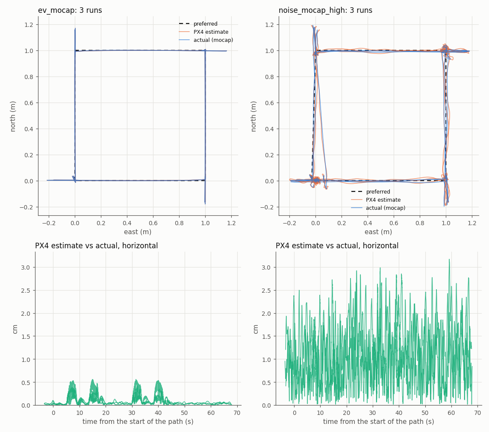
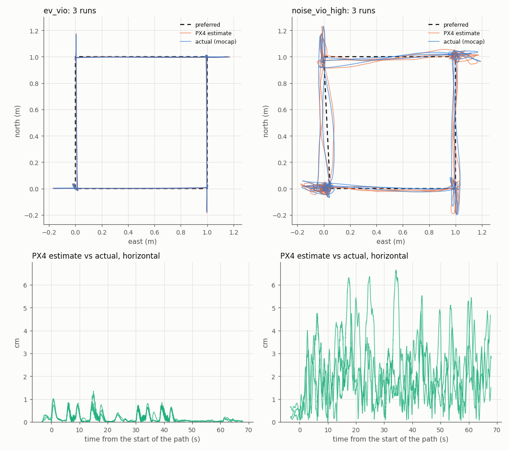

# external_bridge with noisy mocap and VIO (2026-11-21)

How PX4's estimate and the flight change when the mocap or VIO going into `external_bridge` gets noisier. Same path as [external_bridge_2026-11-15.md](external_bridge_2026-11-15.md) (`flight_path`: up, a 1 m square, a 90° turn, a 0.5 m climb and descent, at 1 m altitude), sim only.

**Results in brief**

- Noise reaches the flight only through PX4's estimate. How well the drone follows its estimate (the control error) is the same at every noise level.
- PX4 removes about 60 % of the noise in each position sample. The estimate's error is about 0.4 × the noise per sample, for both sources.
- At the same noise, mocap and VIO come out about the same.
- Mocap: low and mid are the same as perfect. Even at high noise (2 cm), the estimate (1.2 cm RMS) is better than flying on flow.
- VIO: errors grow steadily with noise. Mid is about as good as flow. High is worse than flow, and 6 of 24 holds didn't settle within 5 cm.
- The noise here is white (every sample independent), which PX4 averages out best. Real VIO error is mostly slow drift, which it can't average out, so the VIO numbers here are the best case.

All sets: 3 runs, altitude 1.0 m, climb 0.5 m, turn 90°, wait 10 s, GPS off. Every run flew the whole path. External vision was fused throughout, at every level: `cs_ev_pos` 100 % for mocap, 98–99 % for VIO.

## Setup

The noise is added by the sim sensors themselves (`add_noise` in `perch_sim/poses.py`): Gaussian, independent for every sample, separately on each axis.

- **Position noise:** that many metres σ on x, y and z.
- **Orientation noise:** a random rotation, with that many radians σ about each body axis.
- **VIO velocity noise:** Gaussian on each component of the linear and angular velocity.

There's no drift, latency or dropped samples in this sweep.

| Set | Source | Rate | Position σ | Orientation σ | Linear velocity σ | Angular velocity σ |
|---|---|---|---|---|---|---|
| `mocap_perfect` | `mocap_sim` | 120 Hz | 0 | 0 | | |
| `mocap_low` | | | 1 mm | 0.002 rad (0.11°) | | |
| `mocap_mid` | | | 5 mm | 0.01 rad (0.57°) | | |
| `mocap_high` | | | 2 cm | 0.03 rad (1.7°) | | |
| `vio_perfect` | `fake_vio` | 30 Hz | 0 | 0 | 0 | 0 |
| `vio_low` | | | 5 mm | 0.005 rad (0.29°) | 0.02 m/s | 0.01 rad/s |
| `vio_mid` | | | 2 cm | 0.02 rad (1.1°) | 0.05 m/s | 0.03 rad/s |
| `vio_high` | | | 5 cm | 0.05 rad (2.9°) | 0.1 m/s | 0.1 rad/s |

The perfect sets are the `mocap` and `vio` sets of [external_bridge_2026-11-15.md](external_bridge_2026-11-15.md).

**How the runs work**

- **Truth stays perfect.** For `EV=mocap`, the runner starts a second `mocap_sim` (node `noisy_mocap_sim`) that publishes on `/noisy/mocap/...`, and the bridge reads that. The normal `mocap_sim`, which the eval uses as the truth, stays perfect.
- **VIO needs no second node.** For `EV=vio`, the noise goes on `fake_vio`, which only the bridge reads. The truth is still the perfect `mocap_sim`.
- **What PX4 is told about the noise:**
  - Mocap sends no covariance (it's a `PoseStamped`), so PX4 assumes a fixed σ of 1 cm and 0.02 rad (`EKF2_EVP_NOISE`, `EKF2_EVA_NOISE` in `perch_sim/config/x500_hook.params`), whatever the real noise is. At high noise, that's less than the noise actually there.
  - `fake_vio` sends its real σ as the covariance. PX4 never assumes less than its defaults, 0.1 m and 0.1 rad, so at every level it assumes more noise than there is.
- **Flow:** on in the VIO runs, off in the mocap runs (as `EV=vio` and `EV=mocap` set it).

**Commands.** Uses the runner's `EV_ARGS` option, which isn't committed yet on `feat/external-bridge-eval`:

```bash
EV=mocap EV_ARGS="position_noise:=0.02 orientation_noise:=0.03" RUNS=3 \
  OUT=~/vespr_recordings/flight_accuracy/noise_mocap_high BEFORE=~/vespr_recordings/flight_accuracy/ev_mocap \
  src/perch_eval/scripts/flight_accuracy_runs.sh
EV=vio EV_ARGS="position_noise:=0.05 orientation_noise:=0.05 linear_velocity_noise:=0.1 angular_velocity_noise:=0.1" ...
```

The other levels change only the numbers.

## Results

All errors are measured against mocap truth. Flow (`baseline_flow`, 2026-11-15) is shown for reference.

### Mocap

| Measured with mocap | perfect | low | mid | high | *flow* |
|---|---|---|---|---|---|
| PX4 estimate vs actual while holding, mean / max (cm) | 0.1 / 0.5 | 0.1 / 0.6 | 0.2 / 0.8 | 1.1 / 3.2 | *1.5 / 4.4* |
| Actual vs the plan while holding, mean (cm) | 3.4 | 3.5 | 3.5 | 4.1 | *3.9* |
| Actual off the line while moving, mean (cm) | 1.1 | 1.0 | 1.1 | 1.6 | *3.0* |
| Distance from the target at the end of a hold, mean (cm) | 1.0 | 1.0 | 1.1 | 1.8 | *3.2* |
| Heading, actual vs PX4 estimate, max (deg) | 0.3 | 0.4 | 0.4 | 0.4 | *1.6* |
| Settled within 5 cm after a step (takeoff not counted) | 24 of 24 | 24 of 24 | 24 of 24 | 24 of 24 | *23 of 24* |



*Perfect mocap (left) vs high noise (right). Top: the flight from above; dashed is the plan, orange is PX4's estimate, blue is the actual position. Bottom: PX4's estimate vs the actual position over the flight. Low and mid: [mocap_low.png](noise_sweep_2026-11-21/mocap_low.png), [mocap_mid.png](noise_sweep_2026-11-21/mocap_mid.png).*

### VIO

| Measured with mocap | perfect | low | mid | high | *flow* |
|---|---|---|---|---|---|
| PX4 estimate vs actual while holding, mean / max (cm) | 0.1 / 0.8 | 0.4 / 1.3 | 1.0 / 2.5 | 2.1 / 6.6 | *1.5 / 4.4* |
| Actual vs the plan while holding, mean (cm) | 3.2 | 3.4 | 4.2 | 5.5 | *3.9* |
| Actual off the line while moving, mean (cm) | 1.1 | 1.4 | 2.1 | 3.4 | *3.0* |
| Distance from the target at the end of a hold, mean (cm) | 1.0 | 1.2 | 2.2 | 4.2 | *3.2* |
| Actual altitude while holding, mean (cm) | -0.1 | -0.2 | -0.1 | -1.0 | *-2.4* |
| Heading, actual vs PX4 estimate, max (deg) | 0.3 | 0.3 | 0.5 | 1.0 | *1.6* |
| Settled within 5 cm after a step (takeoff not counted) | 24 of 24 | 24 of 24 | 23 of 24 | 18 of 24 | *23 of 24* |



*Perfect VIO (left) vs high noise (right); same layout. Low and mid: [vio_low.png](noise_sweep_2026-11-21/vio_low.png), [vio_mid.png](noise_sweep_2026-11-21/vio_mid.png).*

## Analysis

### 1. Noise changes the estimate, not how the drone follows it

The eval splits the total error (actual − target) into two parts:

- **estimation:** actual − PX4's estimate
- **control:** PX4's estimate − target

Typical size (RMS, the root mean square) of each, in cm:

| RMS (cm) | mocap perfect | low | mid | high | VIO perfect | low | mid | high |
|---|---|---|---|---|---|---|---|---|
| Estimation, holding, horizontal | 0.1 | 0.1 | 0.3 | 1.2 | 0.2 | 0.5 | 1.1 | 2.5 |
| Estimation, holding, altitude | 0.1 | 0.1 | 0.2 | 0.7 | 0.4 | 0.7 | 0.9 | 1.9 |
| Estimation, moving, off the line | 0.1 | 0.1 | 0.2 | 1.1 | 0.3 | 0.7 | 1.1 | 2.3 |
| Estimation, holding, heading (deg) | 0.03 | 0.04 | 0.04 | 0.08 | 0.03 | 0.05 | 0.16 | 0.50 |
| Control, holding, horizontal | 6.0 | 6.4 | 6.0 | 6.6 | 5.8 | 5.8 | 6.3 | 7.0 |
| Control, moving, along the line | 8.5 | 8.8 | 8.5 | 8.8 | 8.6 | 8.7 | 8.9 | 8.7 |
| Control, moving, off the line | 2.1 | 1.9 | 2.2 | 2.5 | 2.0 | 2.0 | 2.6 | 3.3 |

- **The estimation error grows steadily with noise.**
- **The control error barely moves.** It's already about 6 cm with perfect input. Most of it is the controller overshooting after every step, and that's the same in every set (mean overshoot per hold, cm):

| Hold | mocap perfect | low | mid | high | VIO perfect | low | mid | high |
|---|---|---|---|---|---|---|---|---|
| after north 1.0 m | 16 | 20 | 18 | 18 | 16 | 15 | 16 | 19 |
| after east 1.0 m | 16 | 18 | 17 | 17 | 16 | 16 | 17 | 15 |
| after south 1.0 m | 17 | 17 | 17 | 18 | 17 | 16 | 15 | 18 |
| after west 1.0 m | 18 | 16 | 16 | 18 | 16 | 17 | 18 | 16 |
| after up 0.5 m | 6 | 4 | 4 | 6 | 6 | 5 | 4 | 6 |

So "actual vs the plan" mostly measures the controller. Noise reaches the flight because the drone flies to where PX4 thinks it is: if the estimate is 2 cm off, so is the drone.

**Already there, not caused by noise:** the hold after takeoff (up 1.0 m) never settled in any set. Its final error is 9–11 cm in all of them, perfect included. That's why the settling counts leave takeoff out.

### 2. PX4 removes about 60 % of the noise

EKF2 doesn't take each sample as it is. It weighs each sample against its prediction from the IMU, so much of the independent noise cancels out. Comparing the noise sent with the estimate's error while holding (horizontal noise sent = σ × √2, for x and y together):

| Set | σ per axis | Horizontal noise sent, RMS | Estimate error, RMS | Share left in the estimate |
|---|---|---|---|---|
| `mocap_mid` | 0.5 cm | 0.7 cm | 0.3 cm | about 40 % |
| `mocap_high` | 2 cm | 2.8 cm | 1.2 cm | about 45 % |
| `vio_mid` | 2 cm | 2.8 cm | 1.1 cm | about 40 % |
| `vio_high` | 5 cm | 7.1 cm | 2.5 cm | about 35 % |

**Rule of thumb:** the estimate's error ≈ 0.4 × the noise σ per sample. To keep the estimate within about 1 cm, a source needs σ ≤ about 2 cm. (At the low levels, the error is too close to the perfect-input value to give a meaningful share.)

### 3. Mocap and VIO come out about the same at the same noise

At σ = 2 cm, mocap gives 1.2 cm RMS and VIO 1.1 cm. Two differences in the setup should push them in opposite directions:

- **Mocap sends 4 times as many samples** (120 Hz against 30 Hz). More samples to average should halve its error.
- **PX4 trusts each mocap sample about 10 times more:** 1 cm assumed against at least 10 cm. When PX4 trusts a sample more, the estimate moves further toward each sample, noise included.

That the two cancel out is an explanation, not tested. A test would be `mocap_high` again with `EKF2_EVP_NOISE` set to 0.02, the true σ: if this is right, the error should go down.

### 4. Why VIO high is where settling fails

At `vio_high` the estimate's error is 2.5 cm RMS, and 4.8 cm at the 95th percentile, so it gets close to the 5 cm tolerance by itself.

- **Final error per hold:** 4–6 cm, against 1–2 cm at the other levels.
- **Wobble:** 2–3 cm, against about 1 cm.
- **Result:** 6 of 24 holds didn't settle.

Overshoot didn't change (section 1), so these holds failed because of the estimate, not the controller.

### Not explained yet: heading

Heading noise passes through VIO much more than mocap:

| | Orientation σ | Heading estimate error, RMS | Share left |
|---|---|---|---|
| `mocap_high` | 1.7° | 0.08° | 5 % |
| `vio_high` | 2.9° | 0.50° | 17 % |

That's the opposite of what PX4's settings suggest: it trusts VIO's orientation less (0.1 rad assumed against mocap's 0.02 rad), so it should filter VIO more.

My guess is that VIO's noisy velocity is the cause. It's sent in the body frame, so PX4 has to turn it into the world frame using its heading, and velocity updates can then correct the heading too. Noisy velocity would pull the heading around. Not checked: a run with only `linear_velocity_noise` would show it.

The size is small either way: 1° max at `vio_high`, against flow's 1.6°.

## What this means for the real drone

- **This sweep is the best case.** White noise is what EKF2 averages out best.
- **Mocap:** real mocap noise is mostly like this, and at well under 2 cm. If the real noise looks like this sweep, the estimate should stay within about 1 cm.
- **VIO:** real VIO error is mostly slow **drift**, which PX4 can't separate from real motion. PX4 will follow it, and so will the drone. A sweep of `position_drift` and `yaw_drift` (already supported through `EV_ARGS`) is the test that shows VIO's real limits.
- **Run-to-run variation:** 3 runs per level. Differences under about 0.2 cm, and settling counts within 1 or 2, are within it.

## Files

`noise_sweep_2026-11-21/`:

- `<set>.png`: perfect vs that noise level, for each of the six noisy sets.
- `<set>.json`: the `flight_accuracy` output for every set, including `mocap_perfect.json` and `vio_perfect.json`. The tables above come from these.

Bags and per-run plots (not in git): `~/vespr_recordings/flight_accuracy/noise_{mocap,vio}_{low,mid,high}/`; the perfect sets are in `ev_mocap/` and `ev_vio/`.
