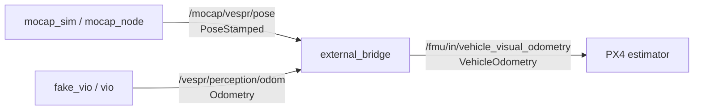

# perch_flight

Flight control nodes. They command PX4 over ROS 2 through the `/fmu/in/*` and `/fmu/out/*` topics (see [topics-and-interfaces.md](../../docs/system-map/topics-and-interfaces.md#px4-topics-through-the-micro-xrce-agent)). The terms used here are explained in [perch_sim](../perch_sim/README.md#terms).

## Test flight: fly_square

`fly_square` is a ROS 2 node that flies a 5 m square at 5 m altitude and lands. It talks to PX4 the same way our real flight code will, so if it works, the whole chain works: sim → Agent → ROS 2 → our code.

1. Terminal 1, start the sim (see [perch_sim](../perch_sim/README.md)) and wait for `Ready for takeoff!`.
2. Terminal 2, start the bridge between PX4 and ROS 2:
   ```bash
   MicroXRCEAgent udp4 -p 8888
   ```
   It prints `session established` once PX4 connects.
3. Terminal 3, build and run the node:
   ```bash
   cd ~/vespr && colcon build --symlink-install && source install/setup.bash
   ros2 run perch_flight fly_square
   ```

Edit `WAYPOINTS` in [perch_flight/fly_square.py](perch_flight/fly_square.py) to change the path. With `--symlink-install` the edit takes effect on the next `ros2 run`, no rebuild needed.

How the node flies the drone:
- Every 0.1 s it publishes the target position to `/fmu/in/trajectory_setpoint`, plus a heartbeat on `/fmu/in/offboard_control_mode`. If these stop for about a second, PX4 assumes the program has crashed and triggers a failsafe (set by `COM_OF_LOSS_T` and `COM_OBL_RC_ACT`).
- It switches PX4 to offboard mode and arms by publishing to `/fmu/in/vehicle_command`.
- It reads the drone's position from `/fmu/out/vehicle_local_position` and its armed state and mode from `/fmu/out/vehicle_status_v1`, and moves to the next waypoint after hovering 2 s at each one.

To see what PX4 is publishing: `ros2 topic list`, then for example `ros2 topic echo /fmu/out/vehicle_local_position`.

## Fly by hand: flight_cli

`flight_cli` lets you fly by typing commands. Start the sim and the Agent as in steps 1 and 2 above, then:

```bash
ros2 run perch_flight flight_cli
```

```
vespr> takeoff               arm and climb to 1.5 m (or takeoff 1.0)
vespr> forward 0.5           relative to the nose points: forward, back, left, right, up, down
vespr> yaw 90                turn in place, + clockwise, - counterclockwise
vespr> goto 0.5 0 1.5        north, east, altitude, relative to the takeoff spot
vespr> speed 0.2             cruise speed for the next moves, up to 1 m/s
vespr> hold                  stop where you are
vespr> status
vespr> land
vespr> quit
```

Type `help` for the full list. Things to know:
- **One move at a time.** A new move is refused until the last one arrives. Use `hold` to stop a move early.
- **Moves are smooth.** The target slides from the last target to the new one at `speed`. Each setpoint carries the target's velocity too, so PX4 follows the target instead of lagging behind it.
- **Pilot takeover.** If PX4 leaves offboard mode in the air (RC mode switch or a failsafe), the CLI stops commanding and says so. `hold` takes control back and holds where the drone is.
- **Ctrl+C or `quit` lands first**, and exits once PX4's land mode has the drone. Press Ctrl+C a second time to exit right away; PX4 then treats it as lost offboard (`COM_OBL_RC_ACT`).

The flying itself is in [perch_flight/commander.py](perch_flight/commander.py) (`Commander`), and the CLI only parses what you type. Other nodes, such as the perch mission, can use `Commander` the same way.

## Fly on mocap or VIO: external_bridge

`external_bridge` feeds an outside pose into PX4's estimator so PX4 flies on it: mocap in stages 1 and 2, VIO in stage 3 (the stages: [mocap.md](../../docs/system-map/mocap.md#phasing-out-mocap)). PX4 calls such a source "external vision" (EV). Design: [docs/design/external_bridge.md](../../docs/design/external_bridge.md).



In the sim, start PX4 with the same source, then the input and the bridge:

```bash
EV=mocap src/perch_sim/scripts/run_sim.sh perch_rod gz_x500_hook     # 1. PX4 set up to fly on the bridge
MicroXRCEAgent udp4 -p 8888                                          # 2.
ros2 launch perch_sim mocap_sim.launch.py world:=perch_rod           # 3. the input
ros2 launch perch_flight external_bridge.launch.py source:=mocap     # 4. the bridge
ros2 run perch_flight flight_cli                                     # 5. fly
```

For VIO: `EV=vio`, `fake_vio.launch.py` and `source:=vio`. The `source` argument is the stage switch.

What it does to each sample:
- **Zeroes at the start.** The bridge averages its first second of input (`zero_window`, in s) and sends PX4 nothing meanwhile. Positions then go to PX4 from where the drone was in that second, with x along the way it faced then (as VIO does). So PX4's local frame starts at the takeoff spot, as on flow, and is the same on mocap and VIO. But x is the starting heading, not north: `goto 1 0 1.5` flies 1 m ahead of where the drone started, and yaw 0 faces that way. Moves relative to the nose (`forward`, `yaw`) don't change.
- **Turns to PX4's axes:** y and z change sign (ROS is x forward, y left, z up; PX4 is y right, z down).
- **Times it on PX4's clock**, detected from the stamp, nothing to set. In the sim the stamps are Gazebo time, which is already PX4's clock: they pass through. On the real drone they are the time of day (over 10⁹ s), and the bridge adds the offset PX4 measures between the clocks (`/fmu/out/timesync_status`); it sends nothing until it has one. See `SYSTEM_CLOCK_MIN_NS` in [perch_flight/external_convert.py](perch_flight/external_convert.py). On the real drone the mocap PC's clock must also agree with the Jetson's (chrony).
- **Mocap:** position and orientation only; PX4 takes how far to trust it from `EKF2_EVP_NOISE` and `EKF2_EVA_NOISE`. **VIO:** also velocity, turning rate and their variances from the `Odometry` covariance.

Checking PX4 uses it, at the `pxh>` prompt: `listener estimator_status_flags` shows `cs_ev_pos`, `cs_ev_hgt` and `cs_ev_yaw` true.

The bridge logs a warning when its input stops for 0.2 s, and drops a sample that arrives out of order. If the input's stamps jump back more than 1 s (a sim reset), it zeroes again (another second's average) and tells PX4 the jump is deliberate.

## References

- [PX4 ROS 2 offboard control example](https://docs.px4.io/main/en/ros2/offboard_control)
